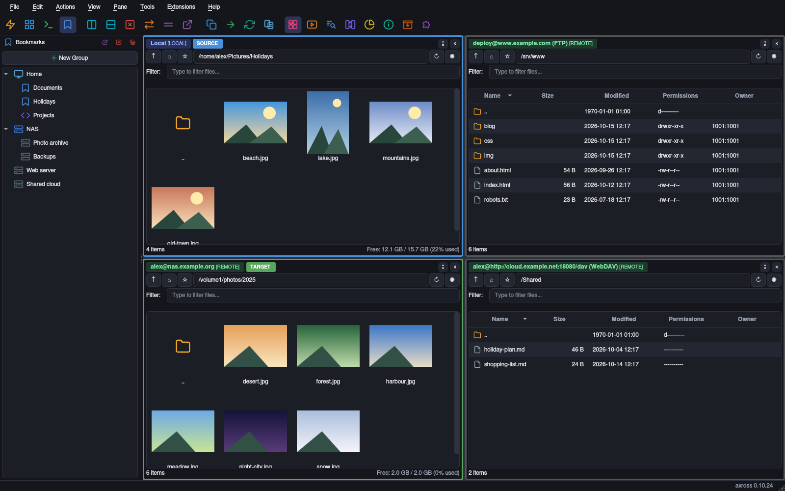
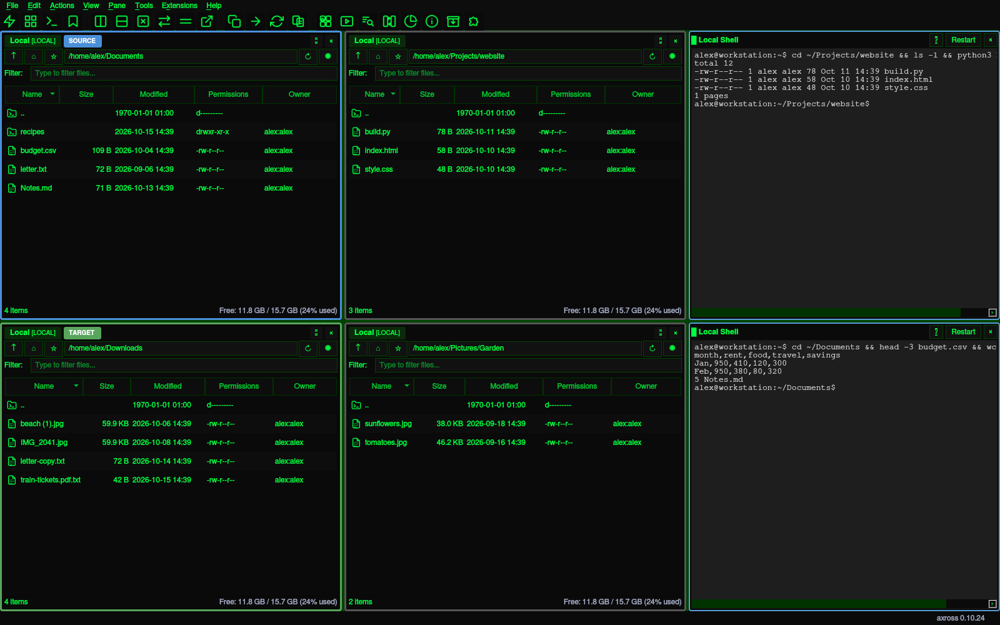

<p align="center">
  
</p>

# Axross

**One UI, 30+ protocols, an embedded Python REPL, and an MCP tool
surface so an LLM can drive the whole thing.**

- **30+ protocols in one window** — SFTP, SMB, S3, WebDAV, cloud drives, IMAP, Git, databases and more.
- **Copy between any two backends** — S3 → SFTP, WebDAV → SMB, directly, no detour via local disk.
- **Commander-style multi-pane layout** — as many split panes as you like, layout presets, drag & drop.
- **Built-in Python scripting** — REPL, Scripts dock and 32 ready-made scripts on one `axross.*` API.
- **LLM-ready via MCP** — an agent drives axross over stdio or HTTP, read-only unless you allow writes.
- **Find duplicates, strip metadata** — content-hash duplicate finder, EXIF/GPS removal before sharing.
- **Encryption without plaintext on disk** — `.axenc` overlay on any backend, decrypted into RAM only.
- **Safe by default** — preview before delete/move, operation journal, `paranoid` mode, SSRF-guarded proxies.
- **Resumable transfers** — survive Ctrl-C and VPN drops, resume from the last verified segment.
- **Install in one line** — `pip install axross`, or a single-file binary from the release page.

Axross is a multi-protocol file manager and security toolkit built
with Python and PyQt6. SFTP, SMB, S3, WebDAV, Cloud drives, IMAP,
Usenet, Cisco IOS, printer-FS, BSD r-services — all in the same
split-pane UI, all callable from the same `axross.*` Python API,
all reachable through MCP for an LLM agent.

Languages: **English** · [Deutsch](README_de.md) · [Español](README_es.md)

---

## Screenshots



*One window, four file systems.* A local folder and an SFTP share side by side in the thumbnail view, an FTP web root and a WebDAV folder below. Every pane names its connection; the blue **SOURCE** and the green **TARGET** set the direction for copy (F5) and move (F6).


*Upload to SFTP.* Four photos copied from the local pane to the NAS; the Transfers dock lists each file with its direction, size and status.



*Hacker Mode.* Four file panes and two local terminals in one layout. Terminals sit in the splitter next to file panes; the presets `dev-shells`, `triage` and `shells-quad` place them for you.


*Amber Mode.* The `quad-files` layout preset: four panes, each with its own path bar, filter, permissions and owner columns. `Ctrl+Alt+L` cycles through the presets.


*Scripts dock.* Your own scripts next to the read-only examples, written against the `axross.*` API; run them in the dock or in the Console.


*Duplicate Finder.* Identical files by content hash, grouped; the oldest copy of each group is shown in bold.


*Metadata.* EXIF fields and the GPS position of a photo; **Remove Metadata** strips them before you share it — in place, or as a cleaned copy (**Tools → Metadata Settings…**).


*Analysis dock.* The optional `sift` extra explains the selected file — here a CSV, without any LLM.


*Modern light theme.* Two panes in the thumbnail view.


*Log dock.* Every copy and move is logged with its integrity check (sha256) and an entry in the operation journal.

---

## 23 highlights

1. **30+ protocols, one consistent UI.** SFTP/SCP, FTP/FTPS, SMB/CIFS,
   WebDAV, S3-compatible, Rsync, NFS, Azure Blob/Files, OneDrive,
   SharePoint, Google Drive, Dropbox, iSCSI, IMAP, POP3, TFTP, Telnet,
   WinRM, WMI/DCOM, Exchange (EWS), DFS-N, ADB, MTP, **Gopher (RFC 1436)**,
   **NNTP / Usenet** (own wire-lib, Python-3.13-safe — stdlib `nntplib`
   is gone), **SQLite-FS / PostgreSQL-FS / Redis-FS / MongoDB GridFS**,
   **Git-as-FS (dulwich)**, **PJL printer-FS** with mandatory safety
   probe, **SLP (RFC 2608)** read-only discovery, **rsh / rcp** legacy
   plaintext, **Cisco IOS Telnet** with `/show/<cmd>.txt` virtual
   files, plus a **RAM-only volatile workspace** (RamFS).

2. **Total-Commander-style multi-pane workflow.** Open as many panes
   as you want, split horizontal/vertical, drag-and-drop between any
   two — including **cross-protocol relay transfers** (S3 → SFTP,
   WebDAV → Rsync, …) without staging on disk.

3. **Layout presets with a cycle hotkey.** Built-in `single`, `dual`,
   `quad-files`, `commander`, `dev-shells`, `triage`, `shells-quad`.
   `Ctrl+Alt+L` rotates forward, `Ctrl+Alt+Shift+L` back.

4. **Embedded Python REPL with 90 public scripting names.** A Console dock
   at the bottom of the GUI, a curated `axross.*` API with file verbs,
   ping/whois/snmp/tls/http helpers, diagnostics, recovery, safety
   previews and result-type classes, persistent history,
   side-effect-free Tab completion (no
   `@property` getters fired by accident), and slash-commands
   `.save / .load / .run / .scripts / .delete`. See
   [docs/SCRIPTING.md](docs/SCRIPTING.md) +
   [docs/SCRIPTING_REFERENCE.md](docs/SCRIPTING_REFERENCE.md).

5. **Inline searchable doc pane.** Right next to the REPL — every
   public `axross.*` function listed by topic, click any to read its
   signature and docstring. Filter live as you type.

6. **32 ready-to-use scripts.** Mirror, dedupe, find-secrets, port-scan,
   SLP inventory, Cisco IOS collection, IMAP archive, sha256-diff,
   bookmarks export, mac-lookup, time-skew, ssh-hostkey-collect,
   tls-cert-survey, http-probe-batch, snmp-walk, ramfs-pipeline, … —
   under [`resources/scripts/`](resources/scripts/), all runnable via
   `axross --script` or the REPL `.run` slash-command.

7. **MCP server mode for LLM agents.** Headless `axross --mcp-server`
   speaks JSON-RPC over stdio or HTTP (mTLS required off loopback)
   and serves the local filesystem under `--mcp-root` (default:
   your home). Read-only by default; `--mcp-write` enables file
   mutations (needs an explicit `--mcp-root`); `--mcp-allow-scripts`
   (stdio only) lets the LLM **write and run its own Python** as
   your user, each run in a child process with a timeout — not
   confined to the root, so treat it as a shell. `--mcp-tools GROUP[,…]` (or `all`) adds capability groups:
   metadata, duplicates, packer, archive, crypto, index, filetype,
   transfer, remote (saved profiles as extra backends, credentials
   only from the keyring, never a prompt) and extensions; their
   mutating tools also need `--mcp-write`. `axross --mcp-list-tools`
   prints the JSON manifest of every tool
   ([docs/mcp-tools.json](docs/mcp-tools.json)). See
   [docs/MCP.md](docs/MCP.md).

8. **Encrypted overlay (`.axenc`).** AEAD-sealed file format that
   drops onto any backend. Decrypt straight into RamFS so plaintext
   never hits disk. The `redact.py` script encrypts every file under
   a path that matches a regex.

9. **OPSEC-aware defaults.** Per-profile shell-history suppression
   (zsh + bash + dash, off-by-flag), plaintext-credential warnings
   on every legacy session (Telnet, rsh, NNTP-on-119), client-banner
   blending into OpenSSH / Firefox-ESR mainstream, mandatory PJL
   safety probe (no accidentally-printed bytes on a non-PJL printer).
   Full breakdown in [docs/OPSEC.md](docs/OPSEC.md).

10. **Operational safety layer.** Mutating operations get redacted
    structured logs and an append-only JSONL operation journal; delete,
    trash and transfer flows can be previewed before execution; the
    Tools menu and `axross.*` scripting API expose backend diagnostics,
    recovery scans and recent operation history. `paranoid` security
    mode blocks external viewers, automatic previews, scripts, legacy
    protocols and private-proxy overrides.

11. **Multi-system workflow verbs.** `axross.where_was_i()` recalls
    the last directory + recent ops on any host you've touched.
    `compare_file([h1, h2, h3], "/etc/nginx.conf")` probes the same
    path on N hosts in parallel and emits a unified diff. `inspect_targets`
    does the same for a heterogenous `(backend, path)` list ("is the
    local /tmp/foo.bin really the same as the S3 object and the SFTP
    copy?"). `federated_search([…])` translates one query into the
    most efficient native search per backend — IMAP SEARCH for IMAP,
    `find_by_query` for DB-FS, generic walker fallback. `dashboard()`
    renders one-screen federation status (text / markdown / json).
    Connection-health pulse keeps every session probed with the
    cheapest no-op the protocol allows; production-tarpit countdown
    fires the first time you do something destructive on a
    `production=True` profile. See
    [docs/MULTI_SYSTEM.md](docs/MULTI_SYSTEM.md) and
    [docs/DAILY_DRIVER.md](docs/DAILY_DRIVER.md).

12. **Reverse-serve over S3 / WebDAV.** `axross.serve_s3(backend)`
    and `axross.serve_webdav(backend)` expose any axross-opened
    backend as a localhost endpoint. restic / aws-cli / terraform /
    rclone / gnome-files / davfs2 / macOS Finder all just work —
    every tool that already speaks S3 or WebDAV gets immediate
    access to whatever protocol axross is fronting (SFTP, SMB, RamFS,
    Postgres-FS, IMAP-as-FS, …). Localhost-bind default + Bearer-token
    auth + read-only mode + path-traversal rejection. See
    [docs/REVERSE_SERVE.md](docs/REVERSE_SERVE.md).

13. **Resilient cross-backend transfers.** `axross.resumable_copy()`
    splits the source into segments, writes a manifest after each,
    and on a re-run picks up from the first incomplete segment after
    verifying the destination's recorded hashes. Survives Ctrl-C,
    VPN drops, crashed interpreters. Pairs with adaptive chunk-sizing
    (BDP-driven, hysteresis-based reassessment, 16 KiB ≤ chunk ≤ 16
    MiB) so long transfers hit a useful chunk size on Gbit LAN, 4G
    and satellite links alike.

14. **Time-lapse / trail.** `axross.snapshot_now(backend, path)`
    plus `start_trail()` keep a SQLite ledger of metadata snapshots
    for any directory tree, on any backend axross speaks. Diff any
    two snapshots to see added / removed / modified files; optional
    first-32-KiB drift hash. Forensic timeline reconstruction +
    change-tracking + growth monitoring without any server-side
    instrumentation. See [docs/TRAIL.md](docs/TRAIL.md).

15. **LLM-friendly directory inspection.** `axross.summarize(backend,
    path)` produces a one-paragraph synopsis from one round-trip —
    counts, extension histogram, age buckets, top-5 by size. No
    body reads. `explain(backend, path)` runs a 15-pattern matcher
    library and answers "what IS this directory?" — git repo,
    PostgreSQL data dir, nginx config tree, k8s manifests, Maildir,
    web-server log dir, Python / Node / Docker projects, … Designed
    so an LLM agent can plan without an N-thousand-entry list_dir
    dump.

16. **Authorised credential testing.** `axross.bruteforce()`,
    `spray()`, `enumerate_users()` for pentest engagements you have
    written authorisation for. Hard `authorized=True` gate (no
    env-var override, blocked under `paranoid` mode), lockout-first
    defaults, password-spray-by-default. Built-in oracles for POP3 +
    FTP/FTPS + statistical-timing fallback for everything else;
    Bearer-only — never V4-signed. See
    [docs/CRED_ATTACK.md](docs/CRED_ATTACK.md).

17. **CVE-mitigated by design.** SLP backend never builds a `SrvReg`
    packet — the SLP amplification path
    ([CVE-2023-29552](https://nvd.nist.gov/vuln/detail/CVE-2023-29552))
    is structurally impossible. Multicast targets are hard-refused
    at the socket layer.

18. **SSRF guard on every proxy hop.** Default-deny against
    cloud-metadata endpoints (169.254.169.254 + AWS IMDS variants)
    and RFC1918 ranges; opt-in via `AXROSS_ALLOW_PRIVATE_PROXY=1`
    when you genuinely need to proxy through a private LAN. In
    `paranoid` mode, that private-proxy override is ignored.

19. **Explicit proxy support.** SOCKS4/5, HTTP CONNECT and HTTPS
    proxies with Basic / NTLM / Negotiate authentication, a global
    default with bypass list and PAC, and a "Test proxy" check.
    Proxy-capable backends route through `core.proxy` — SSH/SCP, Telnet,
    FTP/FTPS, IMAP, POP3, NNTP, WebDAV, SMB/DFS-N, S3, SVN, databases,
    NFSv4 / iSCSI (loopback tunnel) and the cloud transports. Backends
    that cannot be proxied fail closed instead of silently going direct.
    See [docs/PROXY_SUPPORT.md](docs/PROXY_SUPPORT.md).

20. **Backend-agnostic primitives.** Universal trash, atomic writes
    (temp sibling + rename), snapshot timeline, content-addressable
    storage, archive extraction with zip-bomb / zip-slip guards —
    all uniform across every backend.

21. **Pure-Python where possible.** Own NNTP wire-lib, own WebDAV
    impl (no third-party SDK), own SLPv2 packet builder, own Gopher
    reader, own minimum-viable S3 + WebDAV reverse-server on stdlib
    `http.server`. Smaller dep tree, no SDK lock-in, no Python-3.13
    surprise when stdlib modules disappear.

22. **Headless and GUI from the same source.** PyQt6 file manager,
    MCP stdio/HTTP server, or `axross --script <file>` CLI runner.
    Single-file binaries on the release page: Linux (`axross-full`,
    `axross-slim`), macOS on Apple silicon and Windows x64 (`axross-slim`); AppImage and the `Dockerfile.mcp` image build from
    the source ([docs/PACKAGING.md](docs/PACKAGING.md)), and that image
    specifically excludes PyQt6 to stay copyleft-free.

23. **Extensions.** Python plugins add Extensions-menu entries, right-click
    actions and panels (**Extensions → Manage Extensions…**). Every
    extension starts switched off, finding one never runs it, and
    `paranoid` mode loads none. Five bundled examples. See
    [docs/EXTENSIONS.md](docs/EXTENSIONS.md).

---

## Quick start

From PyPI, once a release is published:

```bash
python3 -m venv .venv && source .venv/bin/activate
pip install "axross[all]"
axross              # start the GUI
axross --mcp-server # or expose the local filesystem as MCP tools to an LLM
```

From a source checkout:

```bash
git clone https://github.com/c0decave/axross
cd axross
python3 -m venv .venv && source .venv/bin/activate
pip install -e .
axross              # start the GUI
axross --mcp-server # or expose the local filesystem as MCP tools to an LLM
```

```python
# from the embedded REPL — Console dock, bottom of the window
>>> b = axross.open_url("sftp://alice@example.com/")
>>> for f in b.list_dir("/var/log")[:5]:
...     print(f.name, f.size)
>>> axross.copy(b, "/etc/motd", axross.localfs(), "/tmp/motd")
>>> axross.preview_delete(axross.localfs(), ["/tmp/motd"])
>>> axross.diagnose(b)
>>> axross.help()         # or click the doc pane on the right
```

Base install pulls only what the always-available protocols need
(SFTP, SCP, FTP/FTPS, Telnet, IMAP). Install per-protocol extras:

```bash
pip install "axross[smb]"        # SMB / CIFS + DFS-N
pip install "axross[s3]"         # S3-compatible (boto3)
pip install "axross[webdav]"     # WebDAV (requests + defusedxml)
pip install "axross[onedrive]"   # OneDrive + SharePoint (msal)
pip install "axross[gdrive]"     # Google Drive
pip install "axross[dropbox]"    # Dropbox
pip install "axross[postgres]"   # PostgreSQL-as-FS
pip install "axross[redis]"      # Redis-as-FS
pip install "axross[mongo]"      # MongoDB GridFS
pip install "axross[git]"        # Git-as-FS via dulwich
pip install "axross[all]"        # everything light-weight at once
```

From a source checkout, use `pip install -e ".[smb]"` style extras
instead.

Full table of extras + system tools per protocol:
**[INSTALL.md](INSTALL.md)**.

---

## Documentation

| Document | What it covers |
|---|---|
| [INSTALL.md](INSTALL.md) | Prerequisites, per-protocol extras, OAuth setup, wheel build, dev setup. |
| [docs/USAGE.md](docs/USAGE.md) · [USAGE_de.md](docs/USAGE_de.md) · [USAGE_es.md](docs/USAGE_es.md) | User guide — connections, panes, transfers, terminal, right-click actions. |
| [docs/SCRIPTING.md](docs/SCRIPTING.md) · [SCRIPTING_de.md](docs/SCRIPTING_de.md) · [SCRIPTING_es.md](docs/SCRIPTING_es.md) | REPL + `axross.*` API + slash-commands + 32 bundled scripts + MCP scripting tools. |
| [docs/EXTENSIONS.md](docs/EXTENSIONS.md) | Extensions menu — plugin API, trust model, the five bundled examples. |
| [docs/MCP.md](docs/MCP.md) · [MCP_de.md](docs/MCP_de.md) · [MCP_es.md](docs/MCP_es.md) | MCP server reference — tools, sessions, mTLS, rate limits, hardening. |
| [docs/HANDBUCH.md](docs/HANDBUCH.md) | Full German manual (workflows, dialog reference, keyboard shortcuts). |
| [docs/OPSEC.md](docs/OPSEC.md) | Threat model + per-finding analysis of what the client reveals to servers. |
| [docs/PROXY_SUPPORT.md](docs/PROXY_SUPPORT.md) | SOCKS4/5, HTTP(S) CONNECT, NTLM/Negotiate, default proxy, bypass, PAC — per protocol. |
| [OAUTH_SETUP.md](OAUTH_SETUP.md) | OneDrive / SharePoint / Google Drive / Dropbox app registration recipes. |
| [docs/MULTI_SYSTEM.md](docs/MULTI_SYSTEM.md) · [MULTI_SYSTEM_de.md](docs/MULTI_SYSTEM_de.md) · [MULTI_SYSTEM_es.md](docs/MULTI_SYSTEM_es.md) | Cross-host workflow verbs — `where_was_i`, `compare_file`, `federated_search`, `dashboard`, `resumable_copy`, … |
| [docs/DAILY_DRIVER.md](docs/DAILY_DRIVER.md) · [DAILY_DRIVER_de.md](docs/DAILY_DRIVER_de.md) · [DAILY_DRIVER_es.md](docs/DAILY_DRIVER_es.md) | Production tarpit + adaptive chunk-sizing primitives that sit under the multi-system verbs. |
| [docs/REVERSE_SERVE.md](docs/REVERSE_SERVE.md) · [REVERSE_SERVE_de.md](docs/REVERSE_SERVE_de.md) · [REVERSE_SERVE_es.md](docs/REVERSE_SERVE_es.md) | Expose any axross-opened backend over a minimum-viable S3 / WebDAV API for any tool that already speaks them. |
| [docs/TRAIL.md](docs/TRAIL.md) · [TRAIL_de.md](docs/TRAIL_de.md) · [TRAIL_es.md](docs/TRAIL_es.md) | Time-lapse / change-tracking — periodic metadata snapshots of any directory tree. |
| [docs/CRED_ATTACK.md](docs/CRED_ATTACK.md) · [CRED_ATTACK_de.md](docs/CRED_ATTACK_de.md) · [CRED_ATTACK_es.md](docs/CRED_ATTACK_es.md) | Authorised credential testing — brute-force, password spray, user enumeration with OPSEC defaults. |
| [docs/RED_TEAM_NOTES.md](docs/RED_TEAM_NOTES.md) | Adversarial review of every backend — fixed findings, known-acceptable risks, open follow-ups. |
| [docs/DEVELOPMENT.md](docs/DEVELOPMENT.md) | Test suite, Docker lab, protocol coverage matrix. |
| [docs/PACKAGING.md](docs/PACKAGING.md) | PyPI/sdist/wheel release, PyInstaller bundle, AppImage, headless MCP Docker image. |
| [SECURITY.md](SECURITY.md) | Vulnerability disclosure policy. |
| [CONTRIBUTING.md](CONTRIBUTING.md) | PR scope, code style, contribution licensing. |

---

## Contributing

Pull requests welcome — see [CONTRIBUTING.md](CONTRIBUTING.md).
Security reports: [SECURITY.md](SECURITY.md).

## License

Axross source is **Apache License 2.0** — see [LICENSE](LICENSE),
[NOTICE](NOTICE), and per-dependency attribution in
[THIRD_PARTY_LICENSES.md](THIRD_PARTY_LICENSES.md).

Three distribution layers to be aware of:

1. **Source tree** (this repository) — Apache-2.0. Users `pip install`
   PyQt6 themselves; no GPL component is bundled with the source.
2. **Pre-built PyInstaller bundles** (`dist/axross-slim`,
   `dist/axross-full`, the AppImage) — statically link PyQt6, which
   is GPL-3.0-or-commercial from Riverbank. Any such binary
   redistributed by us is therefore offered under **GPL-3.0** terms.
   For a non-GPL binary, rebuild against PySide6 (LGPL-3.0) from the
   same Apache-2.0 source.
3. **`Dockerfile.mcp`** — explicitly excludes PyQt6; the resulting
   image is Apache-2.0 only, no copyleft inheritance.

Copyright © 2026 Marco Lux.
