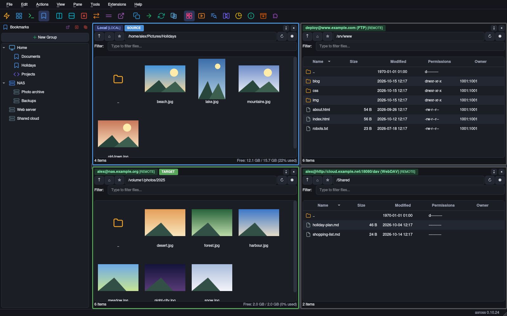
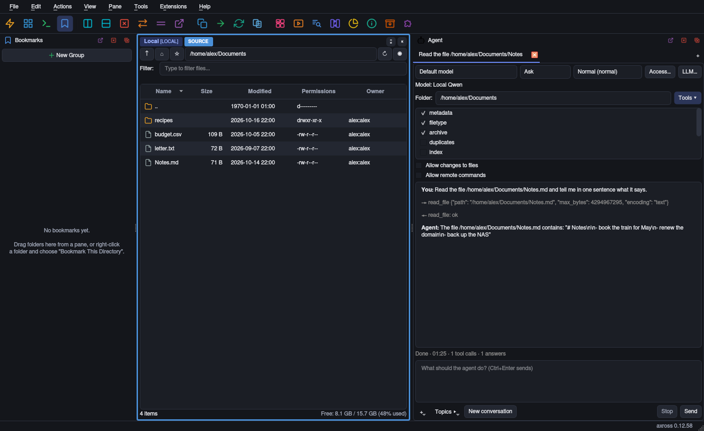
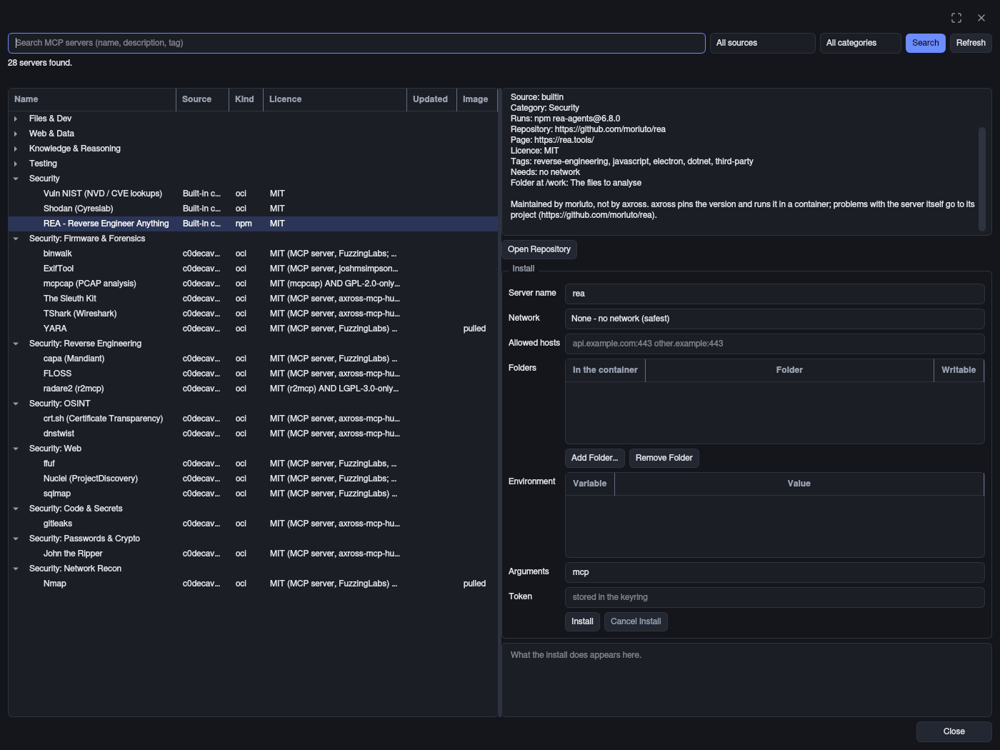
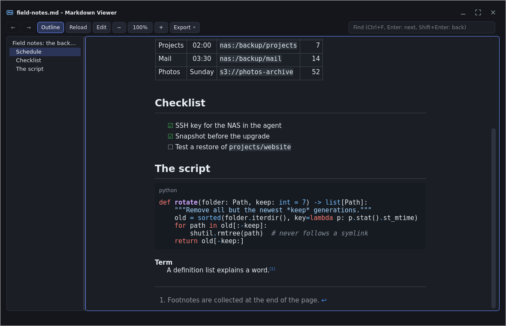
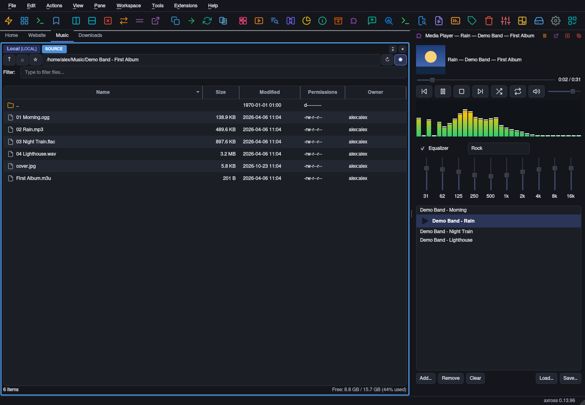

<p align="center">
  
</p>

# Axross

Languages: **English** · [Deutsch](README_de.md) · [Español](README_es.md)

**One UI, 30+ protocols, an embedded Python REPL, and an MCP tool
surface so an LLM can drive the whole thing.**

- **30+ protocols in one window** — SFTP, SMB, S3, WebDAV, cloud drives, IMAP, Git, databases and more.
- **Copy between any two backends** — S3 → SFTP, WebDAV → SMB, directly, no detour via local disk.
- **Commander-style panes and workspaces** — as many split panes as you like, presets, drag & drop, detachable workspace tabs.
- **An LLM agent built in** — Agent dock with sandboxes for LM Studio, Ollama, vLLM or llama.cpp, read-only by default, push-to-talk.
- **MCP server and client** — LLMs drive axross over stdio or HTTP; the agent uses further MCP servers, contained in podman.
- **Built-in Python scripting** — REPL, Scripts dock and 32 ready-made scripts on one `axross.*` API.
- **Editor, Markdown viewer, Find Files** — tabbed editor for remote files, Markdown with math, search inside archives too.
- **Forensics and privacy tools** — disk images, The Sleuth Kit, duplicate finder, metadata removal, `.axenc` files decrypted into RAM only.
- **Safe by default** — preview before delete/move, operation journal, `paranoid` mode, SSRF-guarded proxies.
- **Install in one line** — `pip install axross`, or a single-file binary for Linux, macOS and Windows.

## Contents

- **[Everything in detail: the extended README](docs/README-extended.md)** — 48 highlights, every download, all docs, licences, credits
- [Screenshots](#screenshots)
- [Install](#install)
- [Quick start](#quick-start)
- [Documentation](#documentation)
- [Security](#security)
- [License](#license)

## Screenshots



|  |  |
|:---:|:---:|
| *The LLM agent, in a sandbox* | *MCP servers from a catalog* |
|  |  |
| *The Markdown viewer* | *The Media Player* |

Every screenshot with what it shows: **[the slideshow](slideshow.md)**.

## Install

Each [release](https://github.com/c0decave/axross/releases/latest) has single-file programs (download, `chmod +x`, start; no Python needed):

| Download | For |
|---|---|
| `axross-full`, `axross-slim`, `axross-base` (also `-glibc2.36` and as `.AppImage`) | Linux x86-64, glibc 2.34 or newer |
| `axross-full-macos-arm64`, `axross-slim-macos-arm64` (also as `.dmg`) | macOS on Apple silicon ([first start](docs/PACKAGING.md#macos-binary-the-first-start)) |
| `axross-full-windows-x64.exe`, `axross-slim-windows-x64.exe` | Windows 10 / 11 |
| `pip install "axross[all]"` | any system with Python 3.11+ ([extras per protocol](INSTALL.md)) |

The `full` build has everything, `slim` leaves out the cloud SDKs, Windows protocols, Matrix/XMPP, voice and analysis, `base` adds the rest as packs: **[which axross?](docs/README-extended.md#which-axross)**. Every file is listed in `SHA256SUMS`, signed with the axross release key (`SHA256SUMS.sig`, Ed25519), and the binaries update themselves.

## Quick start

```bash
pip install "axross[all]"
axross              # start the GUI
axross --mcp-server # or expose the local filesystem as MCP tools to an LLM
```

```python
# from the embedded REPL (Console dock)
>>> b = axross.open_url("sftp://alice@example.com/")
>>> axross.copy(b, "/etc/motd", axross.localfs(), "/tmp/motd")
```

From a source checkout and with per-protocol extras: [Quick start in the extended README](docs/README-extended.md#quick-start).

## Documentation

| Guide | What it covers |
|---|---|
| [User guide](docs/USAGE.md) · [Deutsch](docs/USAGE_de.md) · [Español](docs/USAGE_es.md) | Connections, panes, transfers, terminal, every window (Help → Handbook, F1) |
| [Scripting](docs/SCRIPTING.md) · [API reference](docs/SCRIPTING_REFERENCE.md) | The REPL, the `axross.*` API and the bundled scripts |
| [MCP](docs/MCP.md) · [LLM guide](docs/LLM_GUIDE.md) | The MCP server, its tools and hardening; how an LLM drives axross |
| [Extensions](docs/EXTENSIONS.md) | The plugin API and the bundled extensions |
| [Install](INSTALL.md) · [Packaging](docs/PACKAGING.md) | Extras and system tools per protocol; binaries, AppImage, Docker |

Every other document: [the full table](docs/README-extended.md#documentation). What changed: [CHANGELOG.md](CHANGELOG.md).

## Security

Every dependency of a release passes axross's own [supply-chain gate](docs/SUPPLY_CHAIN_GATE.md) before anything is built (OSV, malicious-package feed, YARA, capa, provenance, a 14-day minimum age). Threat model: [docs/OPSEC.md](docs/OPSEC.md). Reporting a vulnerability: [SECURITY.md](SECURITY.md).

## License

Apache-2.0 ([LICENSE](LICENSE), [NOTICE](NOTICE)); the pre-built binaries contain PyQt6 and are offered under GPL-3.0 ([details](docs/README-extended.md#license)). Thanks to every project axross builds on: [Third-party software](docs/README-extended.md#third-party-software-and-thanks). Contributions welcome: [CONTRIBUTING.md](CONTRIBUTING.md).
