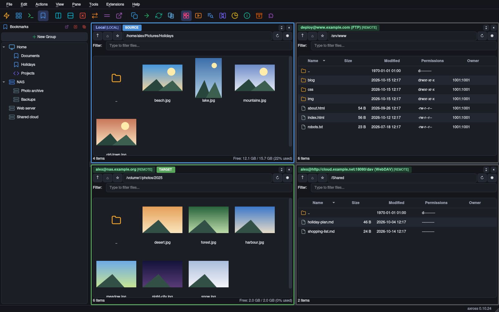
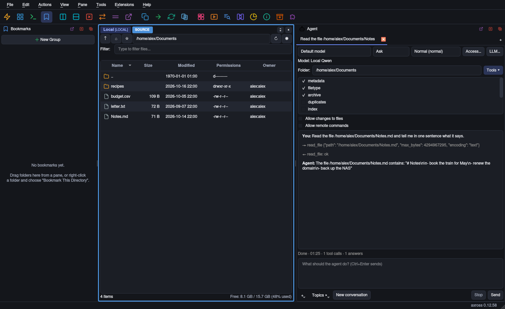
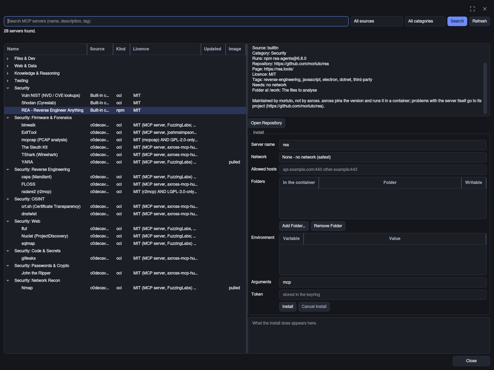
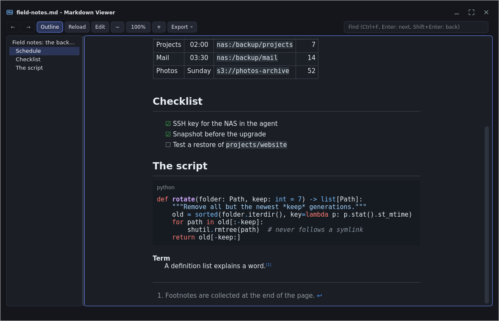
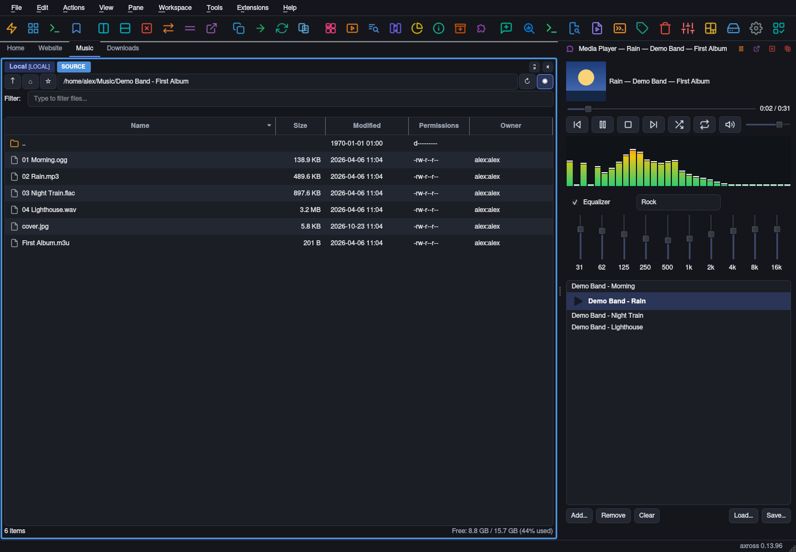

<p align="center">
  
</p>

# Axross

**One UI for 30+ file, cloud, network, legacy, database, scripting,
and MCP workflows.**

- **30+ protocols in one window** — SFTP, SMB, S3, WebDAV, cloud drives, IMAP, Git, databases and more.
- **Copy between any two backends** — S3 → SFTP, WebDAV → SMB, directly, no detour via local disk.
- **Commander-style panes and workspaces** — as many split panes as you like, presets, drag & drop, detachable workspace tabs.
- **An LLM agent built in** — Agent dock with sandboxes for LM Studio, Ollama, vLLM or llama.cpp, read-only by default, push-to-talk.
- **MCP server and client** — LLMs drive axross over stdio or HTTP; the agent uses further MCP servers, contained in podman.
- **Built-in Python scripting** — REPL, Scripts dock and 32 ready-made scripts on one `axross.*` API.
- **Editor, Markdown viewer, Find Files** — tabbed editor for remote files, Markdown with math, search inside archives too.
- **Forensics and privacy tools** — disk images, The Sleuth Kit, duplicate finder, metadata removal, `.axenc` files decrypted into RAM only.
- **Safe by default** — preview before delete/move, operation journal, `paranoid` mode, SSRF-guarded proxies.
- **Install in one line** — `pip install axross`, or a single-file binary for Linux, macOS and Windows.

## Contents

- **[Everything in detail: the extended README](https://github.com/c0decave/axross/blob/main/docs/README-extended.md)** — 48 highlights, every download, all docs, licences, credits
- [Screenshots](#screenshots)
- [Install](#install)
- [First checks](#first-checks)
- [Documentation](#documentation)
- [License](#license)

## Screenshots



|  |  |
|:---:|:---:|
| *The LLM agent, in a sandbox* | *MCP servers from a catalog* |
|  |  |
| *The Markdown viewer* | *The Media Player* |

Every screenshot with what it shows: [the slideshow](https://github.com/c0decave/axross/blob/main/slideshow.md).

## Install

```bash
python -m venv .venv && source .venv/bin/activate
pip install "axross[all]"       # the common light protocol extras; or just: pip install axross
pip install "axross[smb]"       # or one extra per backend: smb, s3, webdav, gdrive, dropbox, git, ...
axross
```

Heavy or platform-sensitive extras stay explicit (`winrm`, `wmi`, `exchange`, `fuse`); every
extra and the system libraries a minimal container needs for the GUI:
[INSTALL.md](https://github.com/c0decave/axross/blob/main/INSTALL.md).

Without Python: each [release](https://github.com/c0decave/axross/releases/latest) has
single-file programs for Linux (`axross-full`, `-slim`, `-base`, also as AppImages), macOS on
Apple silicon (also as disk images) and Windows x64, every file in `SHA256SUMS`, signed with
the axross release key (Ed25519): [which axross?](https://github.com/c0decave/axross/blob/main/docs/README-extended.md#which-axross)

## First checks

```bash
axross --version
axross --script script.py                          # run an axross automation script
axross --mcp-server                                # stdio MCP server for local agents
axross --mcp-server --mcp-http 127.0.0.1:7331      # or over HTTP
python -c "import axross; print(axross.localfs().list_dir('.')[:3])"
```

Headless modes (`--help`, `--script`, `--mcp-server`) work without the GUI libraries.

## Documentation

| Guide | What it covers |
|---|---|
| [User guide](https://github.com/c0decave/axross/blob/main/docs/USAGE.md) | Connections, panes, transfers, terminal, every window |
| [Scripting](https://github.com/c0decave/axross/blob/main/docs/SCRIPTING.md) · [reference](https://github.com/c0decave/axross/blob/main/docs/SCRIPTING_REFERENCE.md) · [examples](https://github.com/c0decave/axross/tree/main/examples/scripting_api) | The `axross.*` API, the REPL and runnable recipes |
| [Multi-system workflows](https://github.com/c0decave/axross/blob/main/docs/MULTI_SYSTEM.md) · [trail](https://github.com/c0decave/axross/blob/main/docs/TRAIL.md) · [reverse-serve](https://github.com/c0decave/axross/blob/main/docs/REVERSE_SERVE.md) | `where_was_i`, `compare_file`, `federated_search`, `resumable_copy`, snapshots, S3 / WebDAV endpoints |
| [MCP server](https://github.com/c0decave/axross/blob/main/docs/MCP.md) | Tools, sessions, mTLS, hardening |
| [OPSEC](https://github.com/c0decave/axross/blob/main/docs/OPSEC.md) · [credential testing](https://github.com/c0decave/axross/blob/main/docs/CRED_ATTACK.md) | What the client reveals; authorised assessments only (`authorized=True`) |
| [Supply-chain gate](https://github.com/c0decave/axross/blob/main/docs/SUPPLY_CHAIN_GATE.md) | How every dependency of a release is checked |

## License

Apache License 2.0; the license, notice and third-party attribution files are in the
[source repository](https://github.com/c0decave/axross).
