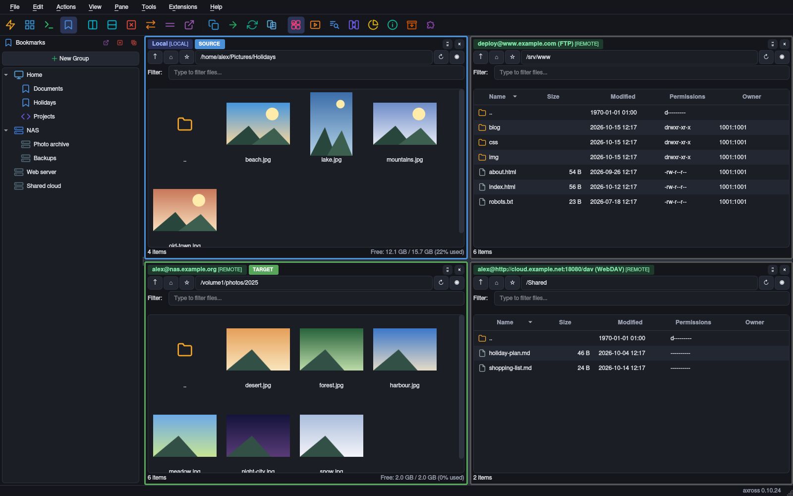
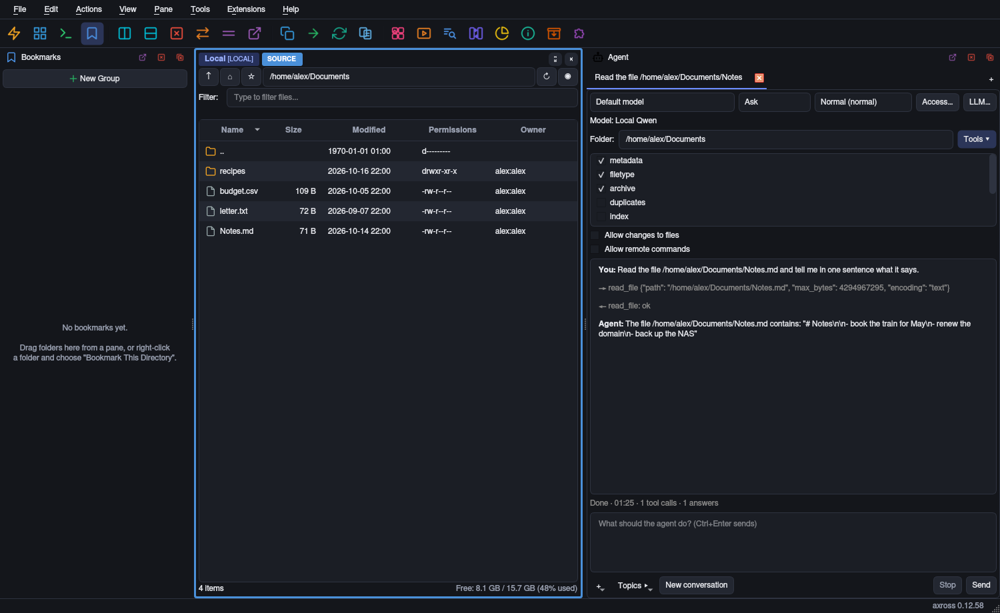
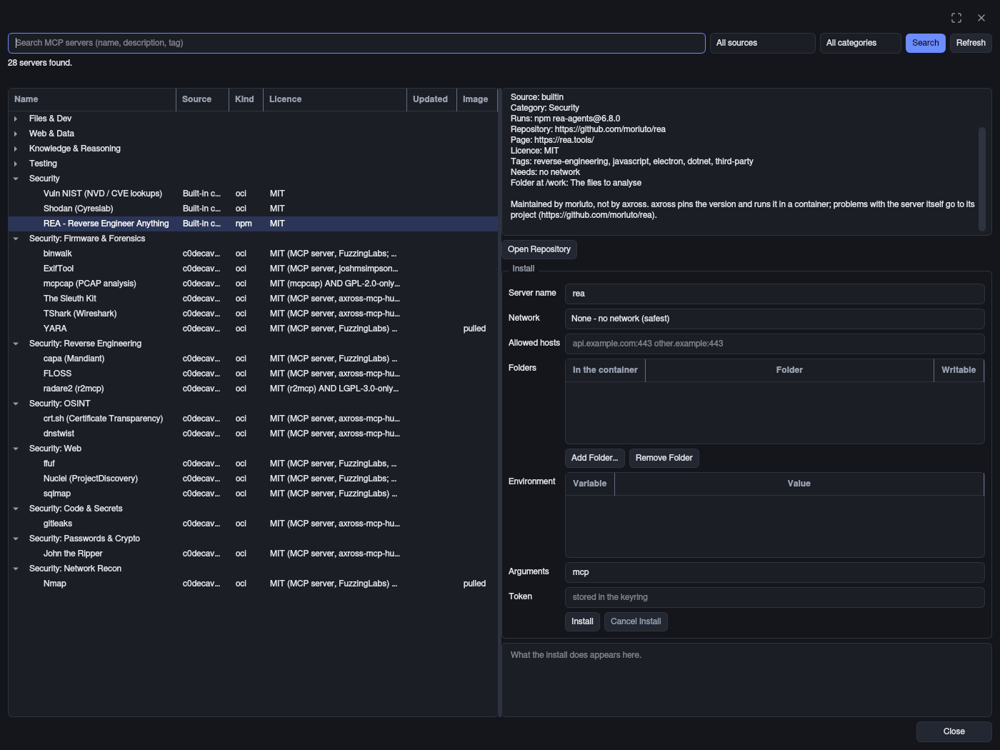
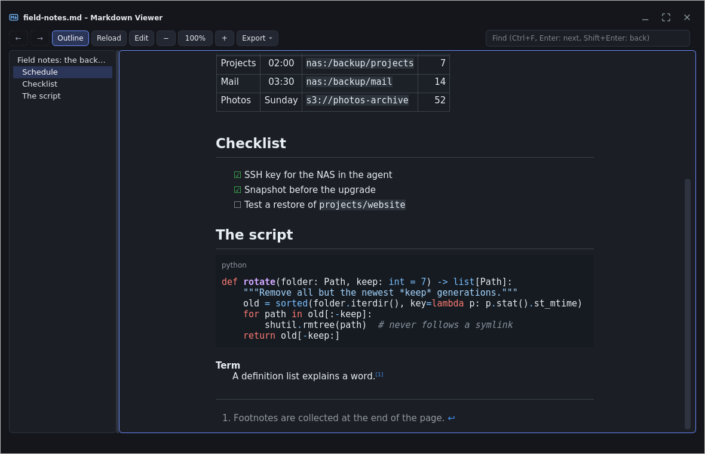
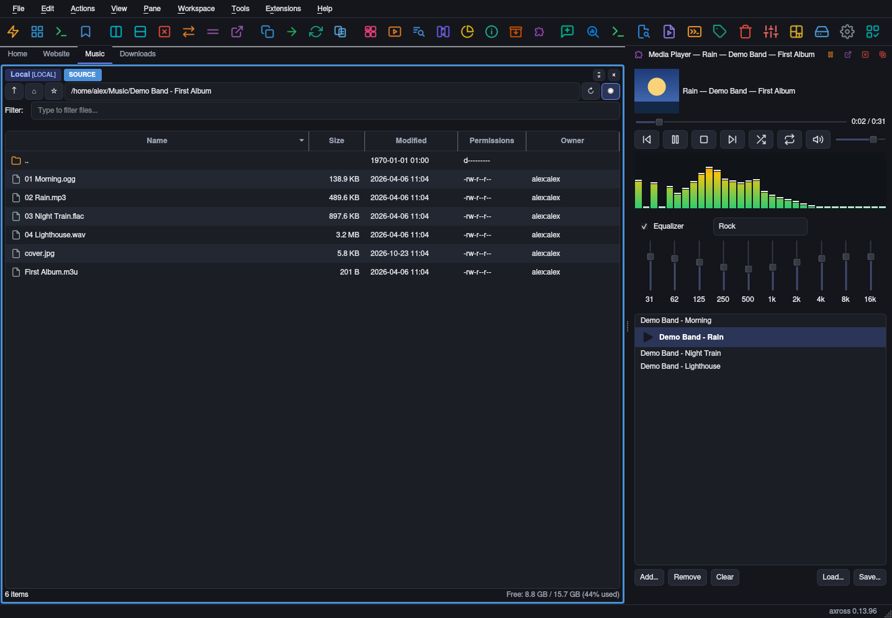

<p align="center">
  
</p>

# Axross

Sprachen: [English](README.md) · **Deutsch** · [Español](README_es.md)

**Eine UI, 30+ Protokolle, ein eingebetteter Python-REPL, und eine
MCP-Tool-Oberfläche, mit der ein LLM das Ganze fernsteuern kann.**

- **30+ Protokolle in einem Fenster** — SFTP, SMB, S3, WebDAV, Cloud-Drives, IMAP, Git, Datenbanken und mehr.
- **Kopieren zwischen beliebigen Backends** — S3 → SFTP, WebDAV → SMB, direkt, ohne Umweg über die lokale Platte.
- **Panes und Workspaces im Commander-Stil** — beliebig viele Split-Panes, Presets, Drag & Drop, abtrennbare Workspace-Tabs.
- **Ein eingebauter LLM-Agent** — Agent-Dock mit Sandboxes für LM Studio, Ollama, vLLM oder llama.cpp, standardmäßig nur lesend, Push-to-Talk.
- **MCP-Server und -Client** — LLMs steuern axross über stdio oder HTTP; der Agent nutzt weitere MCP-Server, eingesperrt in podman.
- **Eingebautes Python-Scripting** — REPL, Scripts-Dock und 32 fertige Skripte auf einer `axross.*`-API.
- **Editor, Markdown-Viewer, Find Files** — Editor mit Tabs für entfernte Dateien, Markdown mit Formeln, Suche auch in Archiven.
- **Forensik- und Privacy-Werkzeuge** — Disk-Images, The Sleuth Kit, Duplikat-Finder, Metadaten entfernen, `.axenc`-Dateien nur im RAM entschlüsselt.
- **Sicher als Standard** — Vorschau vor Löschen/Verschieben, Operation-Journal, `paranoid`-Modus, SSRF-geschützte Proxys.
- **Installation in einer Zeile** — `pip install axross` oder ein Binary in einer Datei für Linux, macOS und Windows.

## Inhalt

- **[Alles im Detail: das ausführliche README](docs/README-extended_de.md)** — 48 Highlights, jeder Download, alle Dokumente, Lizenzen, Dank
- [Screenshots](#screenshots)
- [Installation](#installation)
- [Schnellstart](#schnellstart)
- [Dokumentation](#dokumentation)
- [Sicherheit](#sicherheit)
- [Lizenz](#lizenz)

## Screenshots



|  |  |
|:---:|:---:|
| *Der LLM-Agent, in einer Sandbox* | *MCP-Server aus einem Katalog* |
|  |  |
| *Der Markdown-Viewer* | *Der Media Player* |

Jeder Screenshot mit Erklärung: **[die Slideshow](slideshow_de.md)**.

## Installation

Jedes [Release](https://github.com/c0decave/axross/releases/latest) enthält Programme in einer Datei (herunterladen, `chmod +x`, starten; kein Python nötig):

| Download | Für |
|---|---|
| `axross-full`, `axross-slim`, `axross-base` (auch `-glibc2.36` und als `.AppImage`) | Linux x86-64, glibc 2.34 oder neuer |
| `axross-full-macos-arm64`, `axross-slim-macos-arm64` (auch als `.dmg`) | macOS auf Apple Silicon ([erster Start](docs/PACKAGING.md#macos-binary-the-first-start)) |
| `axross-full-windows-x64.exe`, `axross-slim-windows-x64.exe` | Windows 10 / 11 |
| `pip install "axross[all]"` | jedes System mit Python 3.11+ ([Extras pro Protokoll](INSTALL.md)) |

Das Build `full` hat alles, `slim` lässt Cloud-SDKs, Windows-Protokolle, Matrix/XMPP, Sprache und Analyse weg, `base` holt den Rest als Packs nach: **[Welches axross?](docs/README-extended_de.md#welches-axross)**. Jede Datei steht in `SHA256SUMS`, signiert mit dem axross-Release-Key (`SHA256SUMS.sig`, Ed25519), und die Binaries aktualisieren sich selbst.

## Schnellstart

```bash
pip install "axross[all]"
axross              # GUI starten
axross --mcp-server # oder das lokale Dateisystem als MCP-Tools an einen LLM ausliefern
```

```python
# aus dem eingebetteten REPL (Console-Dock)
>>> b = axross.open_url("sftp://alice@example.com/")
>>> axross.copy(b, "/etc/motd", axross.localfs(), "/tmp/motd")
```

Aus einem Source-Checkout und mit Extras pro Protokoll: [Schnellstart im ausführlichen README](docs/README-extended_de.md#schnellstart).

## Dokumentation

| Anleitung | Inhalt |
|---|---|
| [Handbuch](docs/USAGE_de.md) · [English](docs/USAGE.md) · [Español](docs/USAGE_es.md) | Verbindungen, Panes, Transfers, Terminal, jedes Fenster (Hilfe → Handbuch, F1) |
| [Scripting](docs/SCRIPTING_de.md) · [API-Referenz](docs/SCRIPTING_REFERENCE.md) | Der REPL, die `axross.*`-API und die mitgelieferten Skripte |
| [MCP](docs/MCP_de.md) · [LLM-Guide](docs/LLM_GUIDE.md) | Der MCP-Server, seine Tools und Härtung; wie ein LLM axross bedient |
| [Extensions](docs/EXTENSIONS.md) | Die Plugin-API und die mitgelieferten Extensions |
| [Installation](INSTALL.md) · [Packaging](docs/PACKAGING.md) | Extras und System-Tools pro Protokoll; Binaries, AppImage, Docker |

Jedes weitere Dokument: [die ganze Tabelle](docs/README-extended_de.md#dokumentation). Was sich geändert hat: [CHANGELOG.md](CHANGELOG.md).

## Sicherheit

Jede Abhängigkeit eines Releases durchläuft vor dem Build axross' eigenes [Supply-Chain-Gate](docs/SUPPLY_CHAIN_GATE.md) (OSV, Feed bösartiger Pakete, YARA, capa, Herkunftsnachweise, 14 Tage Mindestalter). Threat-Model: [docs/OPSEC.md](docs/OPSEC.md). Eine Schwachstelle melden: [SECURITY.md](SECURITY.md).

## Lizenz

Apache-2.0 ([LICENSE](LICENSE), [NOTICE](NOTICE)); die fertigen Binaries enthalten PyQt6 und stehen unter GPL-3.0 ([Details](docs/README-extended_de.md#lizenz)). Danke an jedes Projekt, auf dem axross aufbaut: [Third-Party-Software](docs/README-extended_de.md#third-party-software-und-dank). Beiträge willkommen: [CONTRIBUTING.md](CONTRIBUTING.md).
