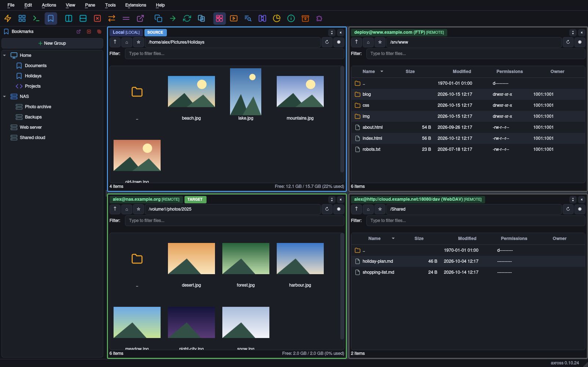
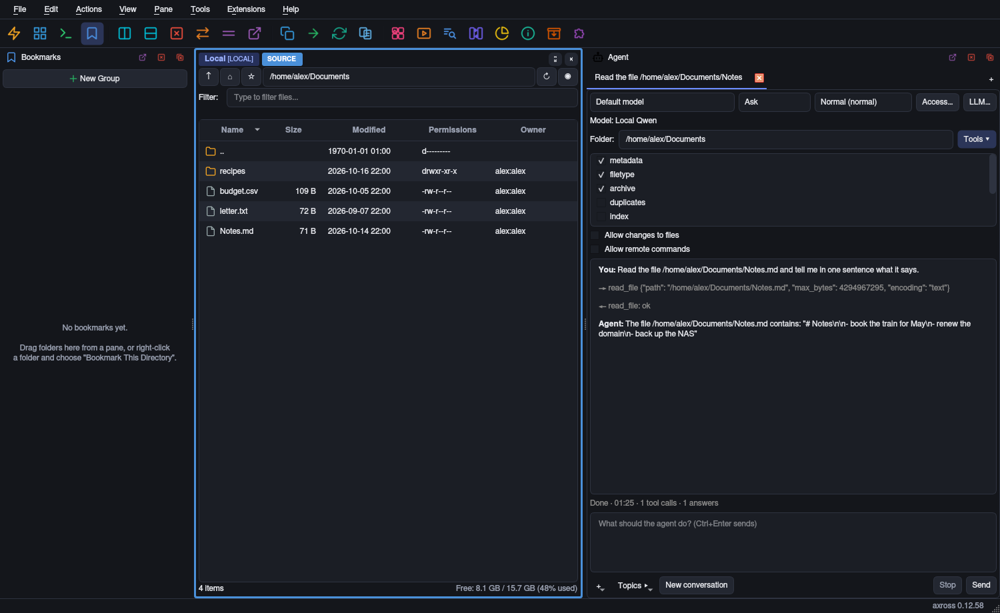
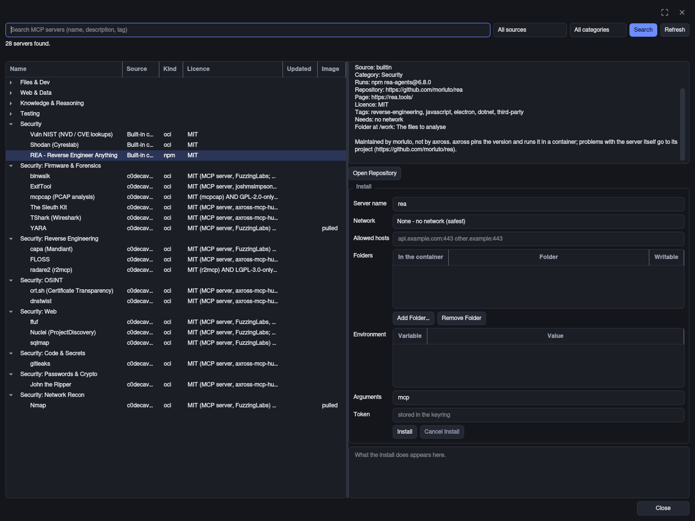
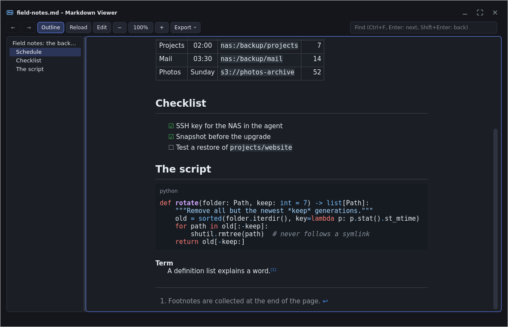
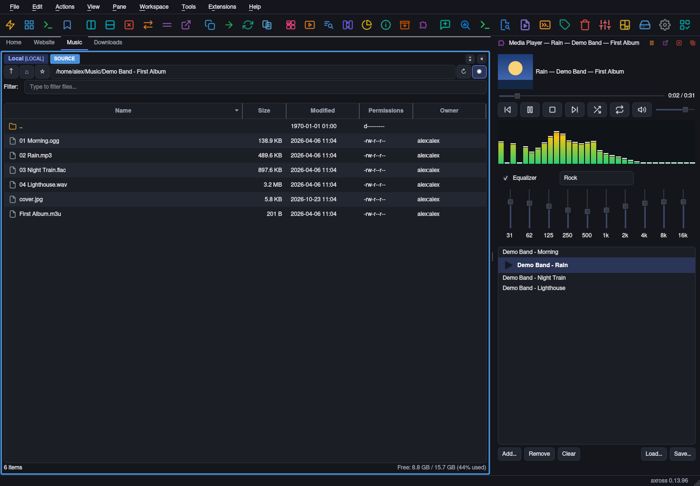

<p align="center">
  
</p>

# Axross

Idiomas: [English](README.md) · [Deutsch](README_de.md) · **Español**

**Una interfaz, más de 30 protocolos, un REPL de Python integrado y una
superficie de herramientas MCP para que un LLM pueda manejarlo todo.**

- **Más de 30 protocolos en una ventana** — SFTP, SMB, S3, WebDAV, nubes, IMAP, Git, bases de datos y más.
- **Copiar entre dos backends cualesquiera** — S3 → SFTP, WebDAV → SMB, directamente, sin pasar por el disco local.
- **Paneles y espacios de trabajo al estilo Commander** — tantos paneles divididos como quieras, presets, arrastrar y soltar, pestañas separables.
- **Un agente LLM integrado** — dock Agent con sandboxes para LM Studio, Ollama, vLLM o llama.cpp, de solo lectura por defecto, pulsar para hablar.
- **Servidor y cliente MCP** — los LLM manejan axross por stdio o HTTP; el agente usa más servidores MCP, encerrados en podman.
- **Scripting en Python integrado** — REPL, dock Scripts y 32 scripts listos sobre una única API `axross.*`.
- **Editor, visor de Markdown, Find Files** — editor con pestañas para archivos remotos, Markdown con fórmulas, búsqueda también en archivos comprimidos.
- **Herramientas forenses y de privacidad** — imágenes de disco, The Sleuth Kit, buscador de duplicados, borrado de metadatos, archivos `.axenc` descifrados solo en RAM.
- **Seguro por defecto** — vista previa antes de borrar o mover, diario de operaciones, modo `paranoid`, proxies protegidos contra SSRF.
- **Instalación en una línea** — `pip install axross`, o un binario de un solo archivo para Linux, macOS y Windows.

## Contenido

- **[Todo en detalle: el README extendido](docs/README-extended_es.md)** — 48 puntos fuertes, cada descarga, toda la documentación, licencias, agradecimientos
- [Capturas de pantalla](#capturas-de-pantalla)
- [Instalación](#instalación)
- [Inicio rápido](#inicio-rápido)
- [Documentación](#documentación)
- [Seguridad](#seguridad)
- [Licencia](#licencia)

## Capturas de pantalla



|  |  |
|:---:|:---:|
| *El agente LLM, en una sandbox* | *Servidores MCP desde un catálogo* |
|  |  |
| *El visor de Markdown* | *El Media Player* |

Cada captura con lo que muestra: **[la presentación](slideshow_es.md)**.

## Instalación

Cada [release](https://github.com/c0decave/axross/releases/latest) trae programas de un solo archivo (descargar, `chmod +x`, iniciar; sin Python):

| Descarga | Para |
|---|---|
| `axross-full`, `axross-slim`, `axross-base` (también `-glibc2.36` y como `.AppImage`) | Linux x86-64, glibc 2.34 o más reciente |
| `axross-full-macos-arm64`, `axross-slim-macos-arm64` (también como `.dmg`) | macOS en Apple silicon ([primer inicio](docs/PACKAGING.md#macos-binary-the-first-start)) |
| `axross-full-windows-x64.exe`, `axross-slim-windows-x64.exe` | Windows 10 / 11 |
| `pip install "axross[all]"` | cualquier sistema con Python 3.11+ ([extras por protocolo](INSTALL.md)) |

La versión `full` lo tiene todo, `slim` deja fuera los SDK de nube, los protocolos de Windows, Matrix/XMPP, la voz y el análisis, `base` añade el resto como packs: **[¿qué axross?](docs/README-extended_es.md#qué-axross)**. Cada archivo figura en `SHA256SUMS`, firmado con la clave de release de axross (`SHA256SUMS.sig`, Ed25519), y los binarios se actualizan solos.

## Inicio rápido

```bash
pip install "axross[all]"
axross              # iniciar la GUI
axross --mcp-server # o exponer el sistema de archivos local como herramientas MCP a un LLM
```

```python
# desde el REPL integrado (dock Console)
>>> b = axross.open_url("sftp://alice@example.com/")
>>> axross.copy(b, "/etc/motd", axross.localfs(), "/tmp/motd")
```

Desde un checkout del código y con extras por protocolo: [Inicio rápido en el README extendido](docs/README-extended_es.md#inicio-rápido).

## Documentación

| Guía | Qué cubre |
|---|---|
| [Manual](docs/USAGE_es.md) · [English](docs/USAGE.md) · [Deutsch](docs/USAGE_de.md) | Conexiones, paneles, transferencias, terminal, cada ventana (Help → Handbook, F1) |
| [Scripting](docs/SCRIPTING_es.md) · [Referencia de la API](docs/SCRIPTING_REFERENCE.md) | El REPL, la API `axross.*` y los scripts incluidos |
| [MCP](docs/MCP_es.md) · [Guía para LLM](docs/LLM_GUIDE.md) | El servidor MCP, sus herramientas y su endurecimiento; cómo un LLM maneja axross |
| [Extensiones](docs/EXTENSIONS.md) | La API de plugins y las extensiones incluidas |
| [Instalación](INSTALL.md) · [Empaquetado](docs/PACKAGING.md) | Extras y herramientas del sistema por protocolo; binarios, AppImage, Docker |

Todos los demás documentos: [la tabla completa](docs/README-extended_es.md#documentación). Qué cambió: [CHANGELOG.md](CHANGELOG.md).

## Seguridad

Cada dependencia de un release pasa la [supply-chain gate](docs/SUPPLY_CHAIN_GATE.md) propia de axross antes de construir nada (OSV, feed de paquetes maliciosos, YARA, capa, procedencia, una antigüedad mínima de 14 días). Modelo de amenazas: [docs/OPSEC.md](docs/OPSEC.md). Informar de una vulnerabilidad: [SECURITY.md](SECURITY.md).

## Licencia

Apache-2.0 ([LICENSE](LICENSE), [NOTICE](NOTICE)); los binarios precompilados contienen PyQt6 y se ofrecen bajo GPL-3.0 ([detalles](docs/README-extended_es.md#licencia)). Gracias a cada proyecto sobre el que se construye axross: [software de terceros](docs/README-extended_es.md#software-de-terceros-y-agradecimientos). Las contribuciones son bienvenidas: [CONTRIBUTING.md](CONTRIBUTING.md).
