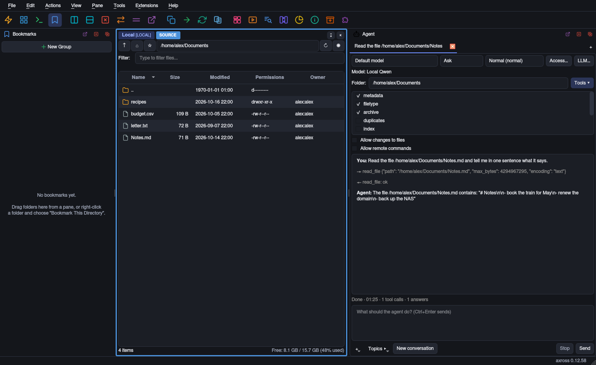

<p align="center">
  
</p>

# Axross

**Una UI, más de 30 protocolos, un REPL de Python embebido y una
superficie de herramientas MCP para que un LLM lo controle todo.**

- **Más de 30 protocolos en una ventana** — SFTP, SMB, S3, WebDAV, nubes, IMAP, Git, bases de datos y más.
- **Copia entre dos backends cualesquiera** — S3 → SFTP, WebDAV → SMB, directo, sin pasar por el disco local.
- **Paneles múltiples estilo Commander** — tantos split panes como quieras, presets de layout, drag & drop.
- **Workspaces** — layouts de paneles con nombre como pestañas, separables en su propia ventana, restaurados en el siguiente arranque.
- **Un agente LLM integrado** — Agent dock con pestañas y sandboxes para LM Studio, Ollama, vLLM o llama.cpp, read-only por defecto.
- **Habla con el agente** — push-to-talk, respuestas habladas en alemán e inglés, speech recognition en local o en el servidor LLM.
- **Servidor y cliente MCP** — los LLM manejan axross por stdio o HTTP, y el agente usa las tools de otros servidores MCP.
- **Scripting en Python integrado** — REPL, dock de Scripts y 32 scripts listos sobre una sola API `axross.*`.
- **Editor de texto con pestañas** — syntax highlighting, buscar/reemplazar, encodings y line endings, en archivos locales y remotos.
- **Find Files** — por nombre, tipo, contenido, tamaño o tag, también dentro de archivos comprimidos, guardado como Smart Folder.
- **Tags de colores** — en cualquier archivo, siguen renombrados y movimientos, como filtro en Find Files.
- **Imágenes de disco y forense** — particiones y sistemas de archivos, loop mount read-only, hashes, The Sleuth Kit, PhotoRec.
- **Media Player** — playlist, M3U, shuffle/repeat, ecualizador de 10 bandas y espectro.
- **Busca duplicados, quita metadatos** — Duplicate Finder por hash de contenido, fuera EXIF/GPS antes de compartir.
- **Cifrado sin texto plano en disco** — overlay `.axenc` en cualquier backend, descifrado solo en RAM.
- **Seguro por defecto** — preview antes de delete/move, journal de operaciones, modo `paranoid`, proxies con guard SSRF.
- **Transfers reanudables** — sobreviven a Ctrl-C y caídas de VPN, siguen desde el último segmento verificado.
- **Archivos comprimidos como carpetas** — explora ZIP, TAR y 7z, también anidados, extrae solo lo elegido, a salvo de zip bombs.
- **Extensions** — Media Player, Forensic Tools, Treemap, VirtualBox y más, cada una apagada hasta que la enciendes.
- **Instalación en una línea** — `pip install axross` o un binario de un solo archivo para Linux, macOS y Windows.

Axross es un gestor de ficheros multiprotocolo y caja de herramientas
de seguridad construido sobre Python y PyQt6. SFTP, SMB, S3, WebDAV,
servicios cloud, IMAP, Usenet, Cisco IOS, FS de impresoras, BSD
r-services — todo en la misma UI con paneles divididos, todo
invocable mediante la misma API `axross.*`, todo accesible vía MCP
para un agente LLM.

Idiomas: [English](README.md) · [Deutsch](README_de.md) · **Español**

---

## Capturas de pantalla


*Una ventana, cuatro sistemas de archivos.* Una carpeta local y un share SFTP lado a lado en la vista de miniaturas, debajo una raíz web FTP y una carpeta WebDAV. Cada panel nombra su conexión; el **SOURCE** azul y el **TARGET** verde fijan la dirección de copy (F5) y move (F6).


*Hacker Mode.* Cuatro paneles de archivos y dos terminales locales en un layout. Los terminales se sitúan en el splitter junto a los paneles de archivos; los presets `dev-shells`, `triage` y `shells-quad` los colocan por ti.



*Dock Agent.* Un modelo local (aquí Qwen 2.5 en llama.cpp) lee un archivo por ti. El tab corre en el sandbox `Normal` (bubblewrap), el modo es `Ask` y cada tool call aparece en el transcript.

Más capturas de pantalla, cada una con su explicación: **[la slideshow](slideshow_es.md)**.

---

## 44 puntos fuertes

1. **Más de 30 protocolos, una UI consistente.** SFTP/SCP, FTP/FTPS,
   SMB/CIFS, WebDAV, S3-compatible, Rsync, NFS, Azure Blob/Files,
   OneDrive, SharePoint, Google Drive, Dropbox, iSCSI, IMAP, POP3,
   TFTP, Telnet, WinRM, WMI/DCOM, Exchange (EWS), DFS-N, ADB, MTP,
   **Gopher (RFC 1436)**, **NNTP / Usenet** (lib propia, compatible
   con Python 3.13 — `nntplib` ha desaparecido del stdlib), **SQLite-
   FS / PostgreSQL-FS / Redis-FS / MongoDB GridFS**, **Git como FS
   (dulwich)**, **PJL FS de impresoras** con sondeo de seguridad
   obligatorio, **SLP (RFC 2608)** descubrimiento sólo lectura, **rsh
   / rcp** legacy en texto plano, **Cisco IOS Telnet** con fichero
   virtual `/show/<cmd>.txt`, más un **espacio de trabajo volátil
   sólo en RAM** (RamFS).

2. **Flujo multipanel estilo Total Commander.** Tantos paneles como
   quieras, divisiones horizontales/verticales, drag-and-drop entre
   dos cualesquiera — incluyendo **transferencias relay entre
   protocolos** (S3 → SFTP, WebDAV → Rsync, …) sin pasar por disco.

3. **Layout-presets con tecla rápida cíclica.** `single`, `dual`,
   `quad-files`, `commander`, `dev-shells`, `triage`, `shells-quad`.
   `Ctrl+Alt+L` rota hacia adelante, `Ctrl+Alt+Shift+L` hacia atrás.

4. **REPL Python embebido con 90 nombres públicos de scripting.** Dock
   inferior `Console`, API `axross.*` curada con verbos de fichero,
   helpers ping/whois/snmp/tls/http, diagnósticos, recovery, previews
   de seguridad y clases de resultado, historia persistente,
   tab-completion sin efectos colaterales (no dispara getters
   `@property`), comandos slash `.save / .load / .run / .scripts /
   .delete`. Ver
   [docs/SCRIPTING_es.md](docs/SCRIPTING_es.md) +
   [docs/SCRIPTING_REFERENCE.md](docs/SCRIPTING_REFERENCE.md).

5. **Panel de documentación con pestañas.** Junto al REPL — cuatro
   pestañas: `API` (todas las funciones `axross.*` con búsqueda y
   docstring completo), `Slash` (todos los comandos slash),
   `Scripts` (los 32 scripts incluidos), `Protocol` (la interfaz
   `FileBackend` que cada backend implementa).

6. **32 scripts listos para usar.** mirror, dedupe, find_secrets,
   port_scan, slp_inventory, recopilación Cisco IOS, archivo IMAP,
   diff sha256, exportar bookmarks, mac_lookup, time_skew,
   ssh_hostkey_collect, tls_cert_survey, http_probe_batch,
   snmp_walk, ramfs_pipeline, … — bajo
   [`resources/scripts/`](resources/scripts/), todos invocables vía
   `axross --script` o desde el REPL con `.run name`.

7. **Modo servidor MCP para agentes LLM.** Headless `axross
   --mcp-server` habla JSON-RPC sobre stdio o HTTP (mTLS obligatorio
   fuera de loopback) y sirve el sistema de ficheros local bajo
   `--mcp-root` (por defecto: tu home). Sólo lectura por defecto;
   `--mcp-write` abre la mutación de ficheros (exige un `--mcp-root`
   explícito); **`--mcp-allow-scripts` (solo stdio) permite al LLM
   escribir y ejecutar sus propios scripts Python con tus permisos**,
   cada ejecución en un proceso hijo con timeout — no confinado a la
   raíz, trátalo como una shell.
   `--mcp-tools GRUPO[,…]` (o `all`) añade grupos de capacidades:
   metadata, duplicates, packer, archive, crypto, index, filetype,
   transfer, remote (perfiles guardados como backends adicionales,
   credenciales solo del keyring, nunca un prompt) y extensions; sus
   herramientas que modifican necesitan además `--mcp-write`. El
   grupo `exec` ejecuta comandos y scripts en hosts remotos (SSH,
   Telnet, rsh, ADB, WinRM, Cisco `show`), solo con su propio
   `--mcp-allow-exec`; `agent` pasa una tarea a tu propio LLM local,
   que puede leer pero no cambia nada. El dock Agent (View > Panels) deja
   que un LLM local trabaje con axross en la ventana y pregunta antes
   de cada cambio.
   `axross --mcp-list-tools` imprime el manifiesto JSON de todas las
   herramientas ([docs/mcp-tools.json](docs/mcp-tools.json)). Ver
   [docs/MCP_es.md](docs/MCP_es.md).

8. **Overlay cifrado (`.axenc`).** Formato de fichero sellado con
   AEAD que se deja caer en cualquier backend. Descifrar
   directamente en RamFS — el texto plano nunca toca disco. El
   script `redact.py` cifra cada fichero bajo una ruta que coincida
   con un regex.

9. **Defaults conscientes de OPSEC.** Supresión per-perfil del
   historial de shell (zsh + bash + dash, desactivable), avisos de
   credenciales en texto plano en cada sesión legacy (Telnet, rsh,
   NNTP en 119), banner de cliente camuflado como OpenSSH /
   Firefox-ESR, sondeo de seguridad PJL obligatorio (sin imprimir
   bytes accidentalmente en una impresora no-PJL). Detalles en
   [docs/OPSEC.md](docs/OPSEC.md).

10. **Capa de seguridad operacional.** Las operaciones mutantes
    escriben logs estructurados redactados y un journal JSONL
    append-only; los flujos de delete, trash y transfer se pueden
    previsualizar antes de ejecutarlos; el menú Tools y la API
    `axross.*` exponen diagnósticos de backend, recovery scans e
    historial reciente de operaciones. El modo `paranoid` bloquea
    viewers externos, previews automáticas, scripts, protocolos
    legacy y overrides de proxy privado.

11. **Verbos de workflow multi-sistema.** `axross.where_was_i()`
    recuerda el último directorio + ops recientes en cualquier host
    que tocaste. `compare_file([h1, h2, h3], "/etc/nginx.conf")`
    sondea el mismo path en N hosts en paralelo y emite un diff
    unificado. `inspect_targets` hace lo mismo para una lista
    heterogénea de pares `(backend, path)` («¿el /tmp/foo.bin local
    es realmente el mismo archivo que el objeto S3 y la copia
    SFTP?»). `federated_search([…])` traduce una consulta a la
    búsqueda nativa más eficiente por backend — IMAP SEARCH para
    IMAP, `find_by_query` para DB-FS, walker genérico si no.
    `dashboard()` rinde estado de federación en una pantalla (text /
    markdown / json). El pulse de connection-health prueba cada
    sesión con el no-op más barato del protocolo; el countdown de
    production-tarpit dispara la primera vez que haces algo
    destructivo en un perfil `production=True`. Ver
    [docs/MULTI_SYSTEM.md](docs/MULTI_SYSTEM.md) y
    [docs/DAILY_DRIVER.md](docs/DAILY_DRIVER.md).

12. **Reverse-serve sobre S3 / WebDAV.** `axross.serve_s3(backend)`
    y `axross.serve_webdav(backend)` exponen cualquier backend
    abierto en axross como endpoint localhost. restic / aws-cli /
    terraform / rclone / gnome-files / davfs2 / macOS Finder
    funcionan sin más — toda herramienta que ya hable S3 o WebDAV
    accede al instante al protocolo que axross esté fronteando
    (SFTP, SMB, RamFS, Postgres-FS, IMAP-as-FS, …). Bind localhost
    por defecto + auth por token por defecto + modo read-only + rechazo de
    path-traversal. Ver
    [docs/REVERSE_SERVE.md](docs/REVERSE_SERVE.md).

13. **Transferencias cross-backend resilientes.**
    `axross.resumable_copy()` divide la fuente en segmentos, escribe
    un manifest tras cada uno, y en re-run sigue desde el primer
    segmento incompleto tras verificar los hashes guardados en
    destino. Sobrevive a Ctrl-C, caídas de VPN, intérpretes
    crasheados. Junto al chunk adaptativo (por BDP, reasesado por
    histéresis, 16 KiB ≤ chunk ≤ 16 MiB) las transferencias largas
    encuentran un tamaño útil en LAN Gbit, 4G y satélite por igual.

14. **Time-lapse / trail.** `axross.snapshot_now(backend, path)`
    junto a `start_trail()` mantiene un ledger SQLite de snapshots
    periódicos de metadata para cualquier árbol de directorios en
    cualquier backend que axross hable. Diff entre dos snapshots
    para ver archivos añadidos / removidos / modificados; opcional
    hash de drift sobre los primeros 32 KiB. Reconstrucción forense
    de timeline + change-tracking + monitoreo de crecimiento sin
    instrumentación del lado servidor. Ver
    [docs/TRAIL.md](docs/TRAIL.md).

15. **Inspección de directorios LLM-friendly.**
    `axross.summarize(backend, path)` produce una síntesis de un
    párrafo en un round-trip — counts, histograma de extensiones,
    age buckets, top-5 por tamaño. Sin lecturas de body.
    `explain(backend, path)` corre una librería de 15 patrones y
    responde «¿qué ES esto?» — repo git, datadir PostgreSQL,
    config-tree nginx, manifests k8s, Maildir, dir de logs,
    proyectos Python / Node / Docker, … Diseñado para que un agente
    LLM planee sin un dump de list_dir de N-mil entradas.

16. **Pruebas de credenciales autorizadas.** `axross.bruteforce()`,
    `spray()`, `enumerate_users()` para engagements de pentest con
    autorización por escrito. Puerta dura `authorized=True` (sin
    override por env-var, bloqueada en modo `paranoid`), defaults
    lockout-first, password-spray-by-default. Oráculos integrados
    para POP3 + FTP/FTPS + fallback estadístico de timing si no.
    Ver [docs/CRED_ATTACK.md](docs/CRED_ATTACK.md).

17. **Mitigación de CVE por diseño.** El backend SLP nunca construye
    un paquete `SrvReg` — el camino de amplificación SLP
    ([CVE-2023-29552](https://nvd.nist.gov/vuln/detail/CVE-2023-29552))
    es estructuralmente imposible. Los destinos multicast se rechazan
    duro a nivel de socket.

18. **Guard SSRF en cada salto proxy.** Deny-por-defecto contra
    endpoints de cloud-metadata (169.254.169.254 + variantes AWS
    IMDS) y rangos RFC1918; opt-in vía
    `AXROSS_ALLOW_PRIVATE_PROXY=1` cuando realmente necesites pasar
    por una LAN privada. En modo `paranoid`, ese override de proxy
    privado se ignora.

19. **SOCKS5 / HTTP-CONNECT explícito.** Los backends con soporte
    real de proxy usan `core.proxy` — SSH/SCP, Telnet, Cisco-Telnet,
    FTP/FTPS, IMAP, POP3, NNTP, WebDAV, SMB/DFS-N, Gopher, PJL,
    WinRM y transportes cloud compatibles. Los backends que no pueden
    respetar SOCKS/HTTP avisan en vez de conectarse directo en silencio. Ver
    [docs/PROXY_SUPPORT.md](docs/PROXY_SUPPORT.md).

20. **Primitivas agnósticas al backend.** Papelera universal,
    escrituras atómicas (temp-sibling + rename), línea-temporal de
    snapshots, almacén content-addressable, extracción de archivos
    con guardas zip-bomb / zip-slip — todo uniforme en cada backend.

21. **Pure-Python donde es posible.** Lib NNTP propia, WebDAV propio
    (sin SDK de terceros), constructor SLPv2 propio, lector Gopher
    propio, reverse-server S3 + WebDAV minimum-viable propio sobre
    `http.server` del stdlib. Árbol de dependencias más pequeño, sin
    SDK lock-in, sin sorpresas con Python 3.13 cuando módulos del
    stdlib desaparecen.

22. **Headless y GUI desde la misma fuente.** Gestor PyQt6, servidor
    MCP stdio/HTTP, o el ejecutador `axross --script <fichero>`.
    Binarios de un solo archivo en la página de releases: Linux
    (`axross-full`, `axross-slim`), macOS en Apple silicon y Windows x64
    (`axross-slim`) - el binario de macOS no está notarizado: antes del primer arranque hay que quitarle el atributo de cuarentena
    ([docs/PACKAGING.md](docs/PACKAGING.md#macos-binary-the-first-start)); el AppImage y la imagen `Dockerfile.mcp`
    se construyen desde el código ([docs/PACKAGING.md](docs/PACKAGING.md)),
    y esa imagen excluye PyQt6 explícitamente para mantenerse libre de
    copyleft.

23. **Extensions.** Plugins en Python añaden entradas al menú Extensions,
    acciones del clic derecho y paneles (**Extensions → Manage
    Extensions…**). Cada extensión empieza desactivada, encontrarla nunca
    la ejecuta y el modo `paranoid` no carga ninguna. Once incluidas,
    entre ellas Media Player, Forensic Tools, Drives Overview, VirtualBox
    y Backup Repositories. Ver [docs/EXTENSIONS.md](docs/EXTENSIONS.md).

24. **Un agente LLM en su propio dock.** **View → Panels → Agent** habla
    con el modelo que eliges en **Agent Settings** (Ollama, LM Studio,
    MLX-LM o cualquier endpoint compatible con OpenAI, como llama.cpp).
    Cada tab es una sesión, guardada como un archivo JSON; los
    protection modes `ask`, `plan`, `auto` y `bypass` deciden qué corre
    sin preguntar; **Topics** ofrece tareas listas; **+** y drag & drop
    desde un panel le pasan archivos, y las conexiones remotas abiertas
    en los paneles se le pueden prestar. El thinking de un modelo se ve
    aparte de su respuesta, plegado en una línea hasta que haces clic; una
    lámpara en la barra de título del dock está verde mientras el LLM
    responde, naranja mientras se le pregunta y roja si no se le alcanza.
    **Topics ▸ + New Topic…** guarda tareas propias; **Settings → Agent →
    Prompts** gestiona perfiles de system/user prompt con nombre;
    **Fetch models** abre una lista con tamaño, parámetros, cuantización y
    el modelo cargado. La extensión incluida **Agent Stats** cuenta runs,
    tool calls y tokens.

25. **Agentes en un sandbox.** Cada tab puede ejecutar su agente en
    bubblewrap, podman o docker, con el nivel `lax`, `normal`, `high` o
    `paranoid` (paranoid: el LLM es el único peer, todas las carpetas
    read-only). La API key nunca entra en el sandbox. Por tab,
    **Access…** concede la red (ninguna, una lista `host:port` o toda,
    nunca por encima del nivel) y carpetas read-only o con escritura, y
    activa o desactiva las funciones de axross que el agente puede usar
    fuera del sandbox.

26. **También un cliente MCP.** **Agent Settings → MCP Servers** conecta
    más servidores MCP (stdio o HTTP); sus tools aparecen en la lista
    **Tools** del tab y preguntan antes de cada llamada o solo antes de
    escribir.

27. **Workspaces.** Layouts de paneles con nombre como pestañas
    (**Workspace → New Workspace**), cada uno separable en su propia
    ventana - otra pantalla o al lado - y de vuelta como pestaña al
    cerrar esa ventana. Un workspace nuevo empieza con una lista de
    archivos o un terminal local, los paneles pasan de un workspace a
    otro por menú o drag & drop, y varias shells quedan una al lado de
    otra. Los workspaces se restauran en el siguiente arranque.

28. **Habla con el agente.** Push-to-talk (F9), modo toggle o
    conversación en el Agent dock. Las respuestas se oyen en alemán o
    inglés con voces Piper, y los términos IT en inglés siguen en
    inglés; cada voz tiene su velocidad, tono, expresividad, volumen y
    pausa, que Listen deja oír en Settings > Voice; el speech recognition corre en local con faster-whisper o en
    el servidor LLM, elegido por perfil. Los modelos se descargan cuando
    hacen falta. Incluido en `axross-full`, si no `pip install
    axross[voice]`.

29. **Un editor de texto con pestañas.** Cada pestaña es un archivo en
    cualquier backend: syntax highlighting con Pygments, buscar y
    reemplazar (regex, mayúsculas, palabra entera), encodings y line
    endings, New / Open… / Save As…, auto-indent; los archivos grandes
    se analizan fuera del hilo de la GUI.

30. **Find Files.** **Edit → Find Files…** (Alt+F7) busca en carpetas
    de cualquier conexión abierta por nombre, preset de tipo, contenido,
    tamaño, fecha y tag, también dentro de archivos comprimidos. Los
    resultados van llegando mientras la ventana sigue usable, y una
    búsqueda se guarda como **Smart Folder** en los bookmarks. El índice
    offline elimina los archivos borrados desde la última indexación.

31. **Tags de colores.** Marca cualquier archivo en cualquier backend -
    **Important** y **Review later** existen desde el principio. Los
    tags siguen renombrados y movimientos y son un filtro en Find Files.

32. **Imágenes de disco y forense.** axross lee cabeceras qcow2, VDI,
    VMDK, VHD/VHDX y E01, tablas de particiones MBR y GPT y sus sistemas
    de archivos sin escribir nada, y monta una partición read-only con
    un loop device. La extensión **Forensic Tools** añade MD5 / SHA-1 /
    SHA-256 en una pasada, `qemu-img`, The Sleuth Kit (explorar y
    extraer, archivos borrados incluidos) y TestDisk/PhotoRec.

33. **Media Player.** Un panel de extensión para MP3, FLAC, Ogg, Opus,
    AAC y más: playlist con drag & drop y M3U, seeking, shuffle y
    repeat, un ecualizador de 10 bandas con presets que se pliega, diez
    visualizaciones (espectro, espejo, radial, espectro en línea y polar,
    waterfall, osciloscopio, stereo scope, vúmetro, starfield) entre las
    que cambia un clic sobre ellas, en esquemas de colores o colores
    propios, en fullscreen como un screensaver o en una ventana propia,
    una playlist que se pliega, título, artista y portada.

34. **Bookmarks para muchos sitios.** Selección múltiple, grupos
    ordenados por nombre, ruta o antigüedad, bookmarks de terminal (en
    un perfil, un host sin perfil o en local) y **Manage Bookmarks**
    como gestor completo.

35. **Todos los settings en un sitio.** **Edit → Settings…** reúne cada
    opción - **Edit → Settings… → Audio** elige PipeWire o PulseAudio, el
    dispositivo de salida y el de entrada con su volumen, y prueba cada
    uno con un tono, un medidor de nivel y una grabación reproducida;
    **Help → Features** muestra qué partes opcionales están instaladas y
    cuáles faltan; **Help → Scripting Guide** abre la guía de la API.

36. **Una toolbar para las herramientas.** Botones con iconos para
    Agent, Analysis (sift), Terminal, Find Files, Scripts, la consola Python,
    Tags, Trash, Media Player, Audio & Video Settings, Treemap, Drives,
    Settings y Features, en cada tema, agrupados por categoría
    (Connections, Windows & Panes, Files & Search, Media, LLM & Agent,
    Tools & System, Extensions), cada categoría con su propio color detrás
    de sus botones. Los botones se mueven con drag and drop dentro de su
    grupo; el orden se conserva entre arranques, y Reset Toolbar Order
    (clic derecho en la toolbar) restaura el orden por defecto. **Edit →
    Settings… → Toolbar** activa o desactiva la agrupación y los colores y
    fija el color de cada categoría.

37. **Archivos comprimidos como carpetas.** Los archivos ZIP, TAR y 7z
    se abren en la vista de archivo; se puede entrar en archivos
    anidados y extraer todo o solo la selección, con protección contra
    zip bombs y zip slip.

38. **Perfiles de agente.** Conjuntos con nombre de lo que recibe un tab
    de Agent: perfil de LLM, perfil de prompt, protection mode, sandbox,
    grupos de tools, funciones de axross, files read-only y servidores MCP
    por categoría o nombre. Siete presets - Files Assistant, Reverse
    Engineering, Forensics read-only, Network & Web Recon, Code & Secrets,
    Remote Ops, Research - y los tuyos en **Settings → Agent → Profiles**,
    con una vista previa de lo que recibe un tab. La flecha **+** del dock
    Agent y **Tools → New Agent Tab from Profile** abren un tab desde un
    perfil, **Apply Profile…** configura un tab abierto, y un servidor MCP
    que falta está a un clic (**Install from Catalog…**).

39. **Servidores MCP de un catálogo, contenidos.** **Add from Catalog…**
    busca en el catálogo incluido, el c0decave MCP Hub (17 herramientas de
    seguridad como binwalk, capa, Nmap, YARA y The Sleuth Kit; solo
    imágenes `ghcr.io/c0decave` fijadas por digest), el namespace `mcp` de
    Docker Hub, el MCP Registry y listas curadas. Lo que se descarga corre
    solo en podman: sin capabilities, sin nuevos privilegios, raíz
    read-only y sin red salvo que la permitas. **Detected on this
    machine** recoge los servidores MCP que tus otras herramientas ya
    configuraron e instala los que descargan de forma contenida. Una
    entrada de terceros como REA dice quién la mantiene.

40. **Cut y Paste de archivos.** Ctrl+X / clic derecho **Cut** marca las
    entradas (atenuadas, en cada panel); Ctrl+V / **Paste** las mueve a la
    carpeta de cualquier panel por la cola de transferencias, y un origen
    se elimina solo cuando su copia terminó y fue verificada - un cut que
    nunca se pega no elimina nada. Esc en la línea de filtro vacía el
    filtro.

41. **Colores de iconos.** **Settings → Appearance → Icon colours**: el
    default del tema, colores propios en cada tema (también Hacker y
    Amber, que si no dibujan cada icono en su color) o un color propio -
    en vivo, y conservado entre cambios de tema y arranques.

42. **Self-update.** `axross-full` y `axross-slim` consultan las releases
    de GitHub una vez por arranque, en segundo plano (**Settings →
    Updates**; desactivado con `AXROSS_NO_UPDATE_CHECK=1` y en modo
    `paranoid`), y muestran **Update to X.Y.Z…** en la barra de estado y
    el menú Help; **Help → Check for Updates…** consulta al instante.
    **Download and Install** comprueba el SHA-256 contra el SHA256SUMS de
    la release y el digest de GitHub, reemplaza el binario de forma
    atómica y conserva el anterior; **Restart Now** lo comprueba de nuevo
    antes de arrancar la versión nueva.

43. **Los ejemplos incluidos corren directamente.** **Run** o **Run in
    Console** en un ejemplo incluido del dock Scripts muestra su llamada
    Usage para ajustarla y ejecuta el ejemplo con ella; **Copy to My
    Scripts** guarda la llamada como una sección comentada "Try it".

44. **Software de terceros, con su crédito.** **Help → Third-Party
    Software…** lista los 222 proyectos que axross usa o incluye -
    propósito, licencia, cómo te llega, enlace - desde el mismo archivo de
    datos que los agradecimientos al final de este README.

---

## Inicio rápido

Desde PyPI, cuando haya una release publicada:

```bash
python3 -m venv .venv && source .venv/bin/activate
pip install "axross[all]"
axross              # arrancar la GUI
axross --mcp-server # o exponer el sistema de ficheros local como herramientas MCP a un LLM
```

Desde un checkout del código:

```bash
git clone https://github.com/c0decave/axross
cd axross
python3 -m venv .venv && source .venv/bin/activate
pip install -e .
axross              # arrancar la GUI
axross --mcp-server # o exponer el sistema de ficheros local como herramientas MCP a un LLM
```

```python
# Desde el REPL embebido — dock Console, abajo en la ventana
>>> b = axross.open_url("sftp://alice@example.com/")
>>> for f in b.list_dir("/var/log")[:5]:
...     print(f.name, f.size)
>>> axross.copy(b, "/etc/motd", axross.localfs(), "/tmp/motd")
>>> axross.preview_delete(axross.localfs(), ["/tmp/motd"])
>>> axross.diagnose(b)
>>> axross.help()         # o haz clic en el panel de docs a la derecha
```

Tabla completa de extras + herramientas de sistema por protocolo:
**[INSTALL.md](INSTALL.md)**.

---

## Documentación

| Documento | Cubre |
|---|---|
| [INSTALL.md](INSTALL.md) | Prerrequisitos, extras por protocolo, OAuth, build de wheel, dev. |
| [docs/USAGE.md](docs/USAGE.md) · [USAGE_de.md](docs/USAGE_de.md) · [USAGE_es.md](docs/USAGE_es.md) | Guía de usuario — conexiones, paneles, transferencias, terminal, acciones de menú. |
| [docs/SCRIPTING.md](docs/SCRIPTING.md) · [SCRIPTING_de.md](docs/SCRIPTING_de.md) · [SCRIPTING_es.md](docs/SCRIPTING_es.md) | REPL + API `axross.*` + comandos slash + 32 scripts incluidos + tools MCP de scripting. |
| [docs/SCRIPTING_REFERENCE.md](docs/SCRIPTING_REFERENCE.md) | Referencia auto-generada de cada función con firma + docstring completo. |
| [docs/MCP.md](docs/MCP.md) · [MCP_de.md](docs/MCP_de.md) · [MCP_es.md](docs/MCP_es.md) | Referencia del servidor MCP — herramientas, sesiones, mTLS, rate limits, hardening. |
| [docs/LLM_GUIDE.md](docs/LLM_GUIDE.md) · [llms.txt](llms.txt) | Para agentes LLM (en inglés): cómo manejar axross por MCP y la API `axross.*` correctamente, con el catálogo de herramientas generado desde el manifiesto. |
| [docs/HANDBUCH.md](docs/HANDBUCH.md) | Manual completo en alemán (workflows, diálogos, atajos de teclado). |
| [docs/OPSEC.md](docs/OPSEC.md) | Modelo de amenazas + análisis de qué revela el cliente al servidor. |
| [docs/PROXY_SUPPORT.md](docs/PROXY_SUPPORT.md) | SOCKS5 / SOCKS4 / HTTP-CONNECT por protocolo. |
| [OAUTH_SETUP.md](OAUTH_SETUP.md) | Recetas de registro de app para OneDrive / SharePoint / Google Drive / Dropbox. |
| [docs/MULTI_SYSTEM.md](docs/MULTI_SYSTEM.md) · [MULTI_SYSTEM_de.md](docs/MULTI_SYSTEM_de.md) · [MULTI_SYSTEM_es.md](docs/MULTI_SYSTEM_es.md) | Verbos de workflow cross-host — `where_was_i`, `compare_file`, `federated_search`, `dashboard`, `resumable_copy`, … |
| [docs/DAILY_DRIVER.md](docs/DAILY_DRIVER.md) · [DAILY_DRIVER_de.md](docs/DAILY_DRIVER_de.md) · [DAILY_DRIVER_es.md](docs/DAILY_DRIVER_es.md) | Tarpit de producción + chunk adaptativo — primitivas debajo de los verbos multi-sistema. |
| [docs/REVERSE_SERVE.md](docs/REVERSE_SERVE.md) · [REVERSE_SERVE_de.md](docs/REVERSE_SERVE_de.md) · [REVERSE_SERVE_es.md](docs/REVERSE_SERVE_es.md) | Exponer cualquier backend axross por API S3 / WebDAV minimum-viable — toda herramienta que ya las hable accede al instante. |
| [docs/TRAIL.md](docs/TRAIL.md) · [TRAIL_de.md](docs/TRAIL_de.md) · [TRAIL_es.md](docs/TRAIL_es.md) | Time-lapse / change-tracking — snapshots periódicos de metadata de cualquier árbol de directorios. |
| [docs/CRED_ATTACK.md](docs/CRED_ATTACK.md) · [CRED_ATTACK_de.md](docs/CRED_ATTACK_de.md) · [CRED_ATTACK_es.md](docs/CRED_ATTACK_es.md) | Pruebas de credenciales autorizadas — fuerza bruta, password spray, enumeración de usuarios con defaults OPSEC. |
| [docs/RED_TEAM_NOTES.md](docs/RED_TEAM_NOTES.md) | Revisión adversaria de cada backend — hallazgos cerrados, riesgos aceptados, follow-ups abiertos. |
| [docs/DEVELOPMENT.md](docs/DEVELOPMENT.md) | Suite de tests, lab Docker, matriz de cobertura por protocolo. |
| [docs/PACKAGING.md](docs/PACKAGING.md) | Release PyPI/sdist/wheel, bundle PyInstaller, AppImage, imagen Docker MCP headless. |
| [SECURITY.md](SECURITY.md) | Política de divulgación de vulnerabilidades. |
| [CONTRIBUTING.md](CONTRIBUTING.md) | Alcance de PRs, estilo de código, licencia de contribución. |

---

## Contribuir

Pull-requests bienvenidos — ver [CONTRIBUTING.md](CONTRIBUTING.md).
Reportes de seguridad: [SECURITY.md](SECURITY.md).

## Licencia

El código fuente de Axross está bajo **Apache License 2.0** — ver
[LICENSE](LICENSE), [NOTICE](NOTICE), y atribuciones por dependencia
en [THIRD_PARTY_LICENSES.md](THIRD_PARTY_LICENSES.md).

Tres capas de distribución a tener en cuenta:

1. **Árbol fuente** (este repositorio) — Apache-2.0. El usuario
   instala PyQt6 por su cuenta vía `pip install`; ningún componente
   GPL viene en la fuente.
2. **Bundles PyInstaller pre-construidos** (`dist/axross-slim`,
   `dist/axross-full`, el AppImage) — enlazan PyQt6 estáticamente,
   que es GPL-3.0-or-commercial de Riverbank. Cualquier binario así
   redistribuido por nosotros se ofrece bajo **GPL-3.0**. Para un
   binario no-GPL, recompila contra PySide6 (LGPL-3.0) desde la
   misma fuente Apache-2.0.
3. **`Dockerfile.mcp`** — excluye PyQt6 explícitamente; la imagen
   resultante es Apache-2.0 únicamente, sin herencia copyleft.

Copyright © 2026 Marco Lux.

---

<!-- third-party:readme -->
<!-- Generated from resources/credits/third_party.json by `python -m core.third_party --write`; edit the data file, not this block. -->

## Software de terceros y agradecimientos

axross se apoya en el trabajo de muchas personas. Gracias a todos los que crean y mantienen los proyectos de abajo: sin ellos axross no existiría.

La lista se genera a partir de [`resources/credits/third_party.json`](resources/credits/third_party.json), los mismos datos que la aplicación muestra en **Help > Third-Party Software…**. Los textos de las licencias y las notas para quien redistribuye están en [THIRD_PARTY_LICENSES.md](THIRD_PARTY_LICENSES.md).

| Proyecto | Para qué | Licencia | Viene con |
|---|---|---|---|
| [adb_shell](https://github.com/JeffLIrion/adb_shell) | Android devices over ADB | Apache-2.0 | axross-full, axross-slim, pip [adb] |
| [axross MCP hub](https://github.com/c0decave/axross-mcp-hub) | Catalogue of container-packaged MCP servers that the MCP catalog installs on request | MIT | imagen de contenedor |
| [azure-storage-blob](https://github.com/Azure/azure-sdk-for-python) | Azure Blob Storage backend | MIT | axross-full, pip [azure] |
| [azure-storage-file-share](https://github.com/Azure/azure-sdk-for-python) | Azure Files backend | MIT | axross-full, pip [azure] |
| [backports.zstd](https://github.com/rogdham/backports.zstd) | Zstandard compression on Python versions before 3.14 | PSF-2.0 | axross-full, axross-slim, pip [archive] |
| [boto3](https://github.com/boto/boto3) | Amazon S3 and S3-compatible storage | Apache-2.0 | axross-full, axross-slim, pip [s3] |
| [Bubblewrap (bwrap)](https://github.com/containers/bubblewrap) | Agent sandbox | LGPL-2.1-or-later | en tu sistema |
| [bzip2](https://sourceware.org/bzip2/) | bzip2 compression (Python's bz2 module) | bzip2-1.0.6 | axross-full, axross-slim |
| [chardet](https://github.com/chardet/chardet) | Text encoding detection | 0BSD | axross-full, axross-slim, pip [encoding] |
| [cryptography](https://github.com/pyca/cryptography) | Encrypted overlay, certificate inspection; cryptography for SSH and TLS | Apache-2.0 OR BSD-3-Clause | axross-full, axross-slim, pip |
| [ctranslate2](https://github.com/OpenNMT/CTranslate2) | Runs the Whisper speech recognition models | MIT | axross-full, pip [voice] |
| [D-Bus](https://www.freedesktop.org/wiki/Software/dbus/) | Desktop bus access of Qt (notifications, portals, keyring) | AFL-2.1 OR GPL-2.0-or-later | axross-full, axross-slim |
| [defusedxml](https://github.com/tiran/defusedxml) | Safe XML parsing (WebDAV responses and other XML input) | PSF-2.0 | axross-full, axross-slim, pip [webdav] |
| [dnspython](https://github.com/rthalley/dnspython) | DNS lookups (scripting helpers and SRV discovery) | ISC | axross-full, axross-slim, pip [dns] |
| [Docker](https://www.docker.com) | Agent sandbox and MCP server containers | Apache-2.0 | en tu sistema |
| [dropbox](https://github.com/dropbox/dropbox-sdk-python) | Dropbox backend | MIT | axross-full, pip [dropbox] |
| [dulwich](https://github.com/dulwich/dulwich) | Git repositories as a file system | Apache-2.0 OR GPL-2.0-or-later | axross-full, axross-slim, pip [git] |
| [espeak-ng](https://github.com/espeak-ng/espeak-ng) | Phonemes for the Piper voices (statically linked into piper's espeakbridge, with its data) | GPL-3.0-or-later | axross-full, pip (con un extra) |
| [exchangelib](https://github.com/ecederstrand/exchangelib) | Microsoft Exchange backend (EWS) | BSD-2-Clause | axross-full, pip [exchange] |
| [Expat](https://libexpat.github.io) | XML parsing (Python's xml modules) | MIT | axross-full, axross-slim |
| [faster-whisper](https://github.com/SYSTRAN/faster-whisper) | Local speech recognition of the Agent dock | MIT | axross-full, pip [voice] |
| [faster-whisper models (Whisper base, small)](https://huggingface.co/Systran) | Local speech recognition models, downloaded in Help > Features… | MIT | descarga bajo demanda |
| [fd](https://github.com/sharkdp/fd) | Find Files: name search | MIT OR Apache-2.0 | axross-full |
| [Feather icons](https://github.com/feathericons/feather) | Style model of axross's own SVG icons (re-drawn, no files copied) | MIT | código de axross |
| [FFmpeg (ffmpeg, ffprobe)](https://ffmpeg.org) | Video thumbnails, media details, removing audio/video metadata | LGPL-2.1-or-later OR GPL-2.0-or-later OR GPL-3.0-only | en tu sistema |
| [fusepy](https://github.com/fusepy/fusepy) | Mounting an axross connection as a local folder (FUSE) | ISC | axross-full, axross-slim, pip [fuse] |
| [GCC runtime libraries](https://gcc.gnu.org) | Fortran, OpenMP and atomic runtimes (numpy, CTranslate2, QtPdf) | GPL-3.0-or-later WITH GCC-exception-3.1 | axross-full, axross-slim |
| [GLib](https://gitlab.gnome.org/GNOME/glib) | Main loop and D-Bus integration of Qt's platform plugins | LGPL-2.1-or-later | axross-full, axross-slim |
| [GNU dbm](https://www.gnu.org.ua/software/gdbm/) | Key-value files of Python's dbm module | GPL-3.0-or-later | axross-full |
| [GNU Readline](https://tiswww.case.edu/php/chet/readline/rltop.html) | Line editing of Python's readline module | GPL-3.0-or-later | axross-full, axross-slim |
| [google-api-python-client](https://github.com/googleapis/google-api-python-client) | Google Drive backend | Apache-2.0 | axross-full, pip [gdrive] |
| [google-auth-httplib2](https://github.com/googleapis/google-cloud-python) | HTTP transport of the Google Drive client | Apache-2.0 | axross-full, pip [gdrive] |
| [google-auth-oauthlib](https://github.com/googleapis/google-cloud-python) | Google sign-in (OAuth) for Google Drive | Apache-2.0 | axross-full, pip [gdrive] |
| [impacket](https://github.com/fortra/impacket) | WMI / DCOM and SMB tooling for Windows hosts | LicenseRef-Impacket-Apache-1.1-modified | axross-full, pip [wmi] |
| [ipwhois](https://github.com/secynic/ipwhois) | WHOIS / RDAP lookups | BSD-2-Clause | axross-full, axross-slim, pip [whois] |
| [jmtpfs / simple-mtpfs / go-mtpfs](https://github.com/JasonFerrara/jmtpfs) | MTP backend (the first one found on PATH) | GPL-3.0-only OR GPL-2.0-or-later OR BSD-3-Clause | en tu sistema |
| [jsonschema](https://github.com/python-jsonschema/jsonschema) | Validates MCP tool arguments against their schemas | MIT | axross-full, axross-slim |
| [keyring](https://github.com/jaraco/keyring) | Stores profile passwords in the operating system's keyring | MIT | axross-full, axross-slim, pip |
| [keyutils](https://git.kernel.org/pub/scm/linux/kernel/git/dhowells/keyutils.git) | Kernel key retention used by MIT Kerberos | LGPL-2.1-or-later | axross-full, axross-slim |
| [ldap3](https://github.com/cannatag/ldap3) | LDAP backend and helpers | LGPL-3.0-or-later | axross-full, axross-slim, pip [ldap] |
| [libcap](https://sites.google.com/site/fullycapable/) | POSIX capabilities used by libsystemd | BSD-3-Clause OR GPL-2.0-only | axross-full, axross-slim |
| [libffi](https://sourceware.org/libffi/) | Foreign function calls (Python's ctypes, cffi) | MIT | axross-full, axross-slim |
| [libfuse 2](https://github.com/libfuse/libfuse) | Kernel FUSE interface of the FUSE mounts (fusepy) | LGPL-2.1-only | axross-full, axross-slim |
| [Libgcrypt and libgpg-error](https://www.gnupg.org/software/libgcrypt/) | Cryptography used by libsystemd | LGPL-2.1-or-later | axross-full, axross-slim |
| [libselinux](https://github.com/SELinuxProject/selinux) | SELinux library used by GLib and libpq | LicenseRef-PublicDomain | axross-full, axross-slim |
| [libsystemd](https://systemd.io) | Journal and D-Bus helpers used by system libraries | LGPL-2.1-or-later AND MIT | axross-full, axross-slim |
| [libxcb and xcb-util](https://xcb.freedesktop.org) | X protocol bindings of Qt's xcb platform plugin | MIT | axross-full, axross-slim |
| [libxkbcommon](https://xkbcommon.org) | Keyboard handling of Qt (X11 and Wayland) | MIT | axross-full, axross-slim |
| [libxml2](https://gitlab.gnome.org/GNOME/libxml2) | XML library used by system libraries | MIT | axross-full, axross-slim |
| [LZ4](https://github.com/lz4/lz4) | LZ4 compression used by system libraries | BSD-2-Clause | axross-full, axross-slim |
| [manuf](https://github.com/coolbho3k/manuf) | MAC address vendor lookup (Wireshark OUI database) | Apache-2.0 OR GPL-3.0-or-later | axross-full, axross-slim, pip [mac] |
| [MIT Kerberos](https://web.mit.edu/kerberos/) | Kerberos / GSSAPI (libpq, system libraries) | MIT | axross-full, axross-slim |
| [mpdecimal](https://www.bytereef.org/mpdecimal/) | Decimal arithmetic of Python's decimal module | BSD-2-Clause | axross-full, axross-slim |
| [msal](https://github.com/AzureAD/microsoft-authentication-library-for-python) | Microsoft sign-in for OneDrive and SharePoint | MIT | axross-full, pip [onedrive] |
| [ncurses (libtinfo)](https://invisible-island.net/ncurses/) | Terminal capabilities used by Readline | X11 | axross-full, axross-slim |
| [nfs-utils (mount.nfs)](https://linux-nfs.org) | NFS backend | GPL-2.0-or-later | en tu sistema |
| [ntplib](https://github.com/cf-natali/ntplib) | NTP time queries | MIT | axross-full, axross-slim, pip [ntp] |
| [numpy](https://github.com/numpy/numpy) | Equalizer and spectrum of the Media Player extension | BSD-3-Clause AND 0BSD AND MIT AND Zlib AND CC0-1.0 | axross-full, pip [media] |
| [onnxruntime](https://github.com/microsoft/onnxruntime) | Runs the Piper voice models | MIT | axross-full, pip [voice] |
| [open-iscsi (iscsiadm)](https://github.com/open-iscsi/open-iscsi) | iSCSI backend | GPL-2.0-or-later | en tu sistema |
| [OpenSSL](https://www.openssl.org) | TLS and cryptography (Python's ssl module, Qt, libpq) | Apache-2.0 | axross-full, axross-slim |
| [paramiko](https://github.com/paramiko/paramiko) | SSH, SFTP and SCP connections | LGPL-2.1-or-later | axross-full, axross-slim, pip |
| [PCRE and PCRE2](https://www.pcre.org) | Regular expressions used by GLib and libselinux | BSD-3-Clause | axross-full, axross-slim |
| [Pillow](https://github.com/python-pillow/Pillow) | Image thumbnails, image metadata and the image viewer | MIT-CMU | axross-full, axross-slim, pip |
| [Piper voices](https://huggingface.co/rhasspy/piper-voices) | The Agent dock's voices, downloaded in Help > Features… | MIT | descarga bajo demanda |
| [piper-tts](https://github.com/OHF-voice/piper1-gpl) | Speech output of the Agent dock (Piper) | GPL-3.0-or-later | axross-full, pip [voice] |
| [Podman](https://podman.io) | Agent sandbox and MCP server containers | Apache-2.0 | en tu sistema |
| [polkit (pkexec)](https://github.com/polkit-org/polkit) | "Open as root…" and privileged mounts | LGPL-2.0-or-later | en tu sistema |
| [psycopg](https://github.com/psycopg/psycopg) | PostgreSQL backend | LGPL-3.0-only | axross-full, axross-slim, pip [postgres] |
| [psycopg-binary](https://github.com/psycopg/psycopg) | Compiled PostgreSQL driver with libpq | LGPL-3.0-only | axross-full, axross-slim |
| [puremagic](https://github.com/cdgriffith/puremagic) | File type detection from file content | MIT | axross-full, axross-slim, pip [magic] |
| [py7zr](https://github.com/miurahr/py7zr) | 7z archives (browse, extract, pack) | LGPL-2.1-or-later | axross-full, axross-slim, pip [archive] |
| [Pygments](https://github.com/pygments/pygments) | Syntax highlighting in the text editor | BSD-2-Clause | axross-full, axross-slim, pip |
| [pymongo](https://github.com/mongodb/mongo-python-driver) | MongoDB / GridFS backend | Apache-2.0 | axross-full, axross-slim, pip [mongo] |
| [pypdf](https://github.com/py-pdf/pypdf) | Removing PDF metadata | BSD-3-Clause | axross-full, axross-slim, pip [metadata] |
| [PyQt6](https://www.riverbankcomputing.com/software/pyqt/) | Python bindings for Qt: the whole user interface | GPL-3.0-only OR LicenseRef-Riverbank-Commercial | axross-full, axross-slim, pip |
| [pysnmp](https://github.com/lextudio/pysnmp) | SNMP helpers | BSD-2-Clause | axross-full, axross-slim, pip [snmp] |
| [PySocks](https://github.com/Anorov/PySocks) | SOCKS4/5 proxies for every connection | BSD-3-Clause | axross-full, axross-slim, pip |
| [Python](https://www.python.org) | The Python interpreter and standard library inside the binaries | PSF-2.0 | axross-full, axross-slim |
| [Python container image (python:3.12-slim)](https://hub.docker.com/_/python) | Base image of Dockerfile.mcp, Dockerfile.agent and Dockerfile.gui | PSF-2.0 AND LicenseRef-Debian-Packages | imagen de contenedor |
| [pywinpty](https://github.com/andfoy/pywinpty) | The local terminal on Windows (ConPTY) | MIT | pip |
| [pywinrm](https://github.com/diyan/pywinrm) | WinRM backend (Windows Remote Management) | MIT | axross-full, pip [winrm] |
| [qemu-img](https://www.qemu.org) | Opening virtual disk images | GPL-2.0-only | en tu sistema |
| [rarfile](https://github.com/markokr/rarfile) | RAR archives (browse, extract) | ISC | axross-full, axross-slim, pip [archive] |
| [redis](https://github.com/redis/redis-py) | Redis backend | MIT | axross-full, axross-slim, pip [redis] |
| [requests](https://github.com/psf/requests) | HTTP client of the WebDAV, OneDrive and other HTTP backends | Apache-2.0 | axross-full, axross-slim, pip [webdav, onedrive] |
| [ripgrep](https://github.com/BurntSushi/ripgrep) | Find Files: content search | MIT OR Unlicense | axross-full |
| [rsh client (netkit-rsh or GNU Inetutils)](https://www.gnu.org/software/inetutils/) | rsh backend | BSD-4-Clause-UC OR GPL-3.0-or-later | en tu sistema |
| [rsync](https://rsync.samba.org) | rsync backend and fast copies | GPL-3.0-or-later | en tu sistema |
| [SecLists](https://github.com/danielmiessler/SecLists) | Public source of the TFTP common-filename wordlist | MIT | código de axross |
| [sift](https://github.com/c0decave/sift) | The Analysis dock's file explanations (sift-summarizer); a sister project of axross | MIT | axross-full, pip (con un extra) |
| [sift-summarizer](https://github.com/c0decave/sift) | sift: the Analysis dock's explanation of the selected file | MIT | axross-full, pip [sift] |
| [Silero VAD](https://github.com/snakers4/silero-vad) | Voice activity detection model that faster-whisper ships | MIT | axross-full, pip (con un extra) |
| [smbprotocol](https://github.com/jborean93/smbprotocol) | SMB / CIFS file shares | MIT | axross-full, axross-slim, pip [smb] |
| [SQLite](https://www.sqlite.org) | Embedded database (Python's sqlite3 module) | blessing | axross-full, axross-slim |
| [Subversion](https://subversion.apache.org) | Subversion backend | Apache-2.0 | en tu sistema |
| [TestDisk / PhotoRec](https://www.cgsecurity.org) | Recovering partitions and files | GPL-2.0-or-later | en tu sistema |
| [tftpy](https://github.com/msoulier/tftpy) | TFTP backend | MIT | axross-full, axross-slim, pip [tftp] |
| [The Sleuth Kit](https://www.sleuthkit.org) | Forensic file system access (fls, icat) | IPL-1.0 AND CPL-1.0 AND GPL-2.0-or-later | en tu sistema |
| [UDisks (udisksctl)](https://github.com/storaged-project/udisks) | Loop-mounting disk images | GPL-2.0-or-later | en tu sistema |
| [urllib3](https://github.com/urllib3/urllib3) | HTTP connection pool (proxies, S3, WebDAV) | MIT | axross-full, axross-slim, pip [git] |
| [util-linux libraries](https://github.com/util-linux/util-linux) | UUIDs, block device and mount information (GLib, Python's uuid module) | LGPL-2.1-or-later AND BSD-3-Clause | axross-full, axross-slim |
| [VirtualBox (VBoxManage)](https://www.virtualbox.org) | VirtualBox disk images | GPL-3.0-only | en tu sistema |
| [X.Org client libraries](https://www.x.org) | X11 display connection of Qt's xcb platform plugin | MIT AND X11 | axross-full, axross-slim |
| [xdg-utils (xdg-open)](https://gitlab.freedesktop.org/xdg/xdg-utils) | Opening files and links with the desktop's programs | MIT | en tu sistema |
| [XZ Utils (liblzma)](https://tukaani.org/xz/) | LZMA/XZ compression (Python's lzma module, Pillow) | 0BSD AND LicenseRef-PublicDomain | axross-full, axross-slim |
| [zlib](https://zlib.net) | Deflate compression (Python, Qt and many libraries) | Zlib | axross-full, axross-slim |
| [Zstandard](https://github.com/facebook/zstd) | Zstandard compression (Pillow, system libraries) | BSD-3-Clause OR GPL-2.0-only | axross-full, axross-slim |

<details>
<summary>114 bibliotecas más que llegan con los proyectos de arriba</summary>

| Proyecto | Usado por | Licencia | Viene con |
|---|---|---|---|
| [alsa-lib](https://github.com/alsa-project/alsa-lib) | PyAV | LGPL-2.1-or-later | axross-full, pip (con un extra) |
| [anyio](https://github.com/agronholm/anyio) | httpx2 | MIT | axross-full, axross-slim, pip (con un extra) |
| [attrs](https://github.com/python-attrs/attrs) | jsonschema | MIT | axross-full, axross-slim |
| [azure-core](https://github.com/Azure/azure-sdk-for-python) | azure-storage-blob | MIT | axross-full, pip (con un extra) |
| [bcrypt](https://github.com/pyca/bcrypt) | paramiko | Apache-2.0 | axross-full, axross-slim, pip |
| [blinker](https://github.com/pallets-eco/blinker) | Flask | MIT | axross-full, pip (con un extra) |
| [botocore](https://github.com/boto/botocore) | boto3 | Apache-2.0 | axross-full, axross-slim, pip (con un extra) |
| [brotli](https://github.com/google/brotli) | py7zr | MIT | axross-full, axross-slim, pip (con un extra) |
| [Brotli (C library)](https://github.com/google/brotli) | Pillow | MIT | axross-full, axross-slim, pip |
| [cached-property](https://github.com/pydanny/cached-property) | exchangelib | BSD-3-Clause | axross-full, pip (con un extra) |
| [certifi](https://github.com/certifi/python-certifi) | requests | MPL-2.0 | axross-full, axross-slim, pip (con un extra) |
| [cffi](https://github.com/python-cffi/cffi) | cryptography | MIT-0 | axross-full, axross-slim, pip |
| [charset-normalizer](https://github.com/jawah/charset_normalizer) | impacket | MIT | axross-full, axross-slim, pip (con un extra) |
| [click](https://github.com/pallets/click) | Flask | BSD-3-Clause | axross-full, axross-slim, pip (con un extra) |
| [Cyrus SASL](https://www.cyrusimap.org/sasl/) | libpq | BSD-Attribution-HPND-disclaimer | axross-full, axross-slim, pip (con un extra) |
| [dav1d](https://code.videolan.org/videolan/dav1d) | PyAV | BSD-2-Clause | axross-full, pip (con un extra) |
| [FFmpeg (PyAV build)](https://ffmpeg.org) | PyAV | LGPL-3.0-or-later | axross-full, pip (con un extra) |
| [FFmpeg (Qt Multimedia build)](https://ffmpeg.org) | Qt 6 | LGPL-2.1-or-later | axross-full, axross-slim, pip |
| [filelock](https://github.com/tox-dev/py-filelock) | huggingface_hub | MIT | axross-full, pip (con un extra) |
| [Flask](https://github.com/pallets/flask) | impacket | BSD-3-Clause | axross-full, pip (con un extra) |
| [FreeType](https://freetype.org) | Pillow | FTL OR GPL-2.0-or-later | axross-full, axross-slim, pip |
| [fsspec](https://github.com/fsspec/filesystem_spec) | huggingface_hub | BSD-3-Clause | axross-full, pip (con un extra) |
| [GMP](https://gmplib.org) | PyAV | LGPL-3.0-or-later OR GPL-2.0-or-later | axross-full, pip (con un extra) |
| [GnuTLS](https://www.gnutls.org) | PyAV | LGPL-2.1-or-later | axross-full, pip (con un extra) |
| [google-api-core](https://github.com/googleapis/google-cloud-python) | google-api-python-client | Apache-2.0 | axross-full, pip (con un extra) |
| [google-auth](https://github.com/googleapis/google-cloud-python) | google-api-python-client | Apache-2.0 | axross-full, pip (con un extra) |
| [googleapis-common-protos](https://github.com/googleapis/google-cloud-python) | google-api-core | Apache-2.0 | axross-full, pip (con un extra) |
| [Graphite](https://github.com/silnrsi/graphite) | HarfBuzz | LGPL-2.1-or-later OR MPL-1.1 OR GPL-2.0-or-later | axross-full, axross-slim |
| [h11](https://github.com/python-hyper/h11) | httpcore2 | MIT | axross-full, axross-slim, pip (con un extra) |
| [HarfBuzz](https://github.com/harfbuzz/harfbuzz) | Qt 6, Pillow | MIT | axross-full, axross-slim, pip |
| [hf-xet](https://github.com/huggingface/xet-core) | huggingface_hub | Apache-2.0 | axross-full, pip (con un extra) |
| [httpcore2](https://github.com/pydantic/httpx2) | httpx2 | BSD-3-Clause | axross-full, axross-slim, pip (con un extra) |
| [httplib2](https://github.com/httplib2/httplib2) | google-api-python-client | MIT | axross-full, pip (con un extra) |
| [httpx2](https://github.com/pydantic/httpx2) | huggingface_hub | BSD-3-Clause | axross-full, axross-slim, pip (con un extra) |
| [huggingface_hub](https://github.com/huggingface/huggingface_hub) | faster-whisper | Apache-2.0 | axross-full, pip (con un extra) |
| [ICU](https://icu.unicode.org) | Qt 6 | Unicode-DFS-2016 | axross-full, axross-slim, pip |
| [idna](https://github.com/kjd/idna) | requests | BSD-3-Clause | axross-full, axross-slim, pip (con un extra) |
| [inflate64](https://github.com/miurahr/inflate64) | py7zr | LGPL-2.1-or-later | axross-full, axross-slim, pip (con un extra) |
| [Intel VPL dispatcher](https://github.com/intel/libvpl) | PyAV | MIT | axross-full, pip (con un extra) |
| [invoke](https://github.com/pyinvoke/invoke) | paramiko | BSD-2-Clause | axross-full, axross-slim, pip |
| [isodate](https://github.com/gweis/isodate) | azure-storage-blob | BSD-3-Clause | axross-full, pip (con un extra) |
| [itsdangerous](https://github.com/pallets/itsdangerous) | Flask | BSD-3-Clause | axross-full, pip (con un extra) |
| [jaraco.classes](https://github.com/jaraco/jaraco.classes) | keyring | MIT | axross-full, axross-slim, pip |
| [jaraco.context](https://github.com/jaraco/jaraco.context) | keyring | MIT | axross-full, axross-slim, pip |
| [jaraco.functools](https://github.com/jaraco/jaraco.functools) | keyring | MIT | axross-full, axross-slim, pip |
| [JBIG-KIT](https://www.cl.cam.ac.uk/~mgk25/jbigkit/) | LibTIFF | GPL-2.0-or-later | axross-full, axross-slim |
| [jeepney](https://gitlab.com/takluyver/jeepney) | keyring | MIT | axross-full, axross-slim, pip |
| [Jinja2](https://github.com/pallets/jinja) | Flask | BSD-3-Clause | axross-full, pip (con un extra) |
| [jmespath](https://github.com/jmespath/jmespath.py) | boto3 | MIT | axross-full, axross-slim, pip (con un extra) |
| [jsonschema-specifications](https://github.com/python-jsonschema/jsonschema-specifications) | jsonschema | MIT | axross-full, axross-slim |
| [libavif](https://github.com/AOMediaCodec/libavif) | Pillow | BSD-2-Clause | axross-full, axross-slim, pip |
| [libdrm](https://gitlab.freedesktop.org/mesa/drm) | PyAV | MIT | axross-full, pip (con un extra) |
| [libjpeg-turbo](https://libjpeg-turbo.org) | Pillow, Qt 6 | IJG AND BSD-3-Clause | axross-full, axross-slim, pip |
| [libpng](https://www.libpng.org) | Pillow, Qt 6 | libpng-2.0 | axross-full, axross-slim, pip |
| [libpq](https://www.postgresql.org) | psycopg-binary | PostgreSQL | axross-full, axross-slim, pip (con un extra) |
| [LibTIFF](https://libtiff.gitlab.io/libtiff/) | Pillow, Qt 6 | libtiff | axross-full, axross-slim, pip |
| [libunistring](https://www.gnu.org/software/libunistring/) | PyAV | LGPL-3.0-or-later OR GPL-2.0-or-later | axross-full, pip (con un extra) |
| [libvpx](https://chromium.googlesource.com/webm/libvpx) | PyAV | BSD-3-Clause | axross-full, pip (con un extra) |
| [libwebp](https://chromium.googlesource.com/webm/libwebp) | Pillow, Qt 6 | BSD-3-Clause | axross-full, axross-slim, pip |
| [libxcrypt](https://github.com/besser82/libxcrypt) | libpq | LGPL-2.1-or-later | axross-full, axross-slim, pip (con un extra) |
| [Little CMS](https://www.littlecms.com) | Pillow | MIT | axross-full, axross-slim, pip |
| [lxml](https://github.com/lxml/lxml) | exchangelib | BSD-3-Clause | axross-full, pip (con un extra) |
| [MarkupSafe](https://github.com/pallets/markupsafe) | Flask | BSD-3-Clause | axross-full, pip (con un extra) |
| [more-itertools](https://github.com/more-itertools/more-itertools) | jaraco.classes | MIT | axross-full, axross-slim, pip |
| [multivolumefile](https://github.com/miurahr/multivolume) | py7zr | LGPL-2.1-or-later | axross-full, axross-slim, pip (con un extra) |
| [Nettle](https://www.lysator.liu.se/~nisse/nettle/) | PyAV | LGPL-3.0-or-later OR GPL-2.0-or-later | axross-full, pip (con un extra) |
| [oauthlib](https://github.com/oauthlib/oauthlib) | exchangelib | BSD-3-Clause | axross-full, pip (con un extra) |
| [OpenBLAS](https://github.com/OpenMathLib/OpenBLAS) | numpy | BSD-3-Clause | axross-full, pip (con un extra) |
| [OpenJPEG](https://www.openjpeg.org) | Pillow | BSD-2-Clause | axross-full, axross-slim, pip |
| [OpenLDAP client libraries](https://www.openldap.org) | libpq | OLDAP-2.8 | axross-full, axross-slim, pip (con un extra) |
| [opentelemetry-api](https://github.com/open-telemetry/opentelemetry-python) | google-api-core | Apache-2.0 | axross-full, axross-slim, pip (con un extra) |
| [Opus](https://opus-codec.org) | PyAV | BSD-3-Clause | axross-full, pip (con un extra) |
| [packaging](https://github.com/pypa/packaging) | onnxruntime | Apache-2.0 OR BSD-2-Clause | axross-full, pip (con un extra) |
| [pathvalidate](https://github.com/thombashi/pathvalidate) | piper-tts | MIT | axross-full, pip (con un extra) |
| [protobuf](https://github.com/protocolbuffers/protobuf) | onnxruntime | BSD-3-Clause | axross-full, pip (con un extra) |
| [psutil](https://github.com/giampaolo/psutil) | py7zr | BSD-3-Clause | axross-full, axross-slim, pip (con un extra) |
| [pyasn1](https://github.com/pyasn1/pyasn1) | adb_shell | BSD-2-Clause | axross-full, axross-slim, pip (con un extra) |
| [pyasn1_modules](https://github.com/pyasn1/pyasn1-modules) | impacket | BSD-2-Clause | axross-full, pip (con un extra) |
| [PyAV](https://github.com/PyAV-Org/PyAV) | faster-whisper | BSD-3-Clause | axross-full, pip (con un extra) |
| [pybcj](https://github.com/miurahr/pybcj) | py7zr | LGPL-2.1-or-later | axross-full, axross-slim, pip (con un extra) |
| [pycparser](https://github.com/eliben/pycparser) | cffi | BSD-3-Clause | axross-full, axross-slim, pip |
| [pycryptodomex](https://github.com/Legrandin/pycryptodome) | impacket | BSD-2-Clause AND LicenseRef-PublicDomain | axross-full, axross-slim, pip (con un extra) |
| [PyJWT](https://github.com/jpadilla/pyjwt) | msal | MIT | axross-full, axross-slim, pip (con un extra) |
| [PyNaCl](https://github.com/pyca/pynacl) | paramiko | Apache-2.0 | axross-full, axross-slim, pip |
| [pyOpenSSL](https://github.com/pyca/pyopenssl) | impacket | Apache-2.0 | axross-full, axross-slim, pip (con un extra) |
| [pyparsing](https://github.com/pyparsing/pyparsing) | httplib2 | MIT | axross-full, pip (con un extra) |
| [pyppmd](https://github.com/miurahr/pyppmd) | py7zr | LGPL-2.1-or-later | axross-full, axross-slim, pip (con un extra) |
| [PyQt6_sip](https://github.com/Python-SIP/sip) | PyQt6 | BSD-2-Clause | axross-full, axross-slim, pip |
| [pyspnego](https://github.com/jborean93/pyspnego) | smbprotocol | MIT | axross-full, axross-slim, pip (con un extra) |
| [python-dateutil](https://github.com/dateutil/dateutil) | botocore | Apache-2.0 AND BSD-3-Clause | axross-full, axross-slim, pip (con un extra) |
| [PyYAML](https://github.com/yaml/pyyaml) | ctranslate2 | MIT | axross-full, axross-slim, pip (con un extra) |
| [Qt 6](https://www.qt.io) | PyQt6 | LGPL-3.0-only | axross-full, axross-slim, pip |
| [referencing](https://github.com/python-jsonschema/referencing) | jsonschema | MIT | axross-full, axross-slim |
| [requests-oauthlib](https://github.com/requests/requests-oauthlib) | exchangelib | ISC | axross-full, pip (con un extra) |
| [requests_ntlm](https://github.com/requests/requests-ntlm) | exchangelib | ISC | axross-full, pip (con un extra) |
| [rpds-py](https://github.com/crate-py/rpds) | jsonschema | MIT | axross-full, axross-slim |
| [rsa](https://github.com/sybrenstuvel/python-rsa) | adb_shell | Apache-2.0 | axross-full, axross-slim, pip (con un extra) |
| [s3transfer](https://github.com/boto/s3transfer) | boto3 | Apache-2.0 | axross-full, axross-slim, pip (con un extra) |
| [SecretStorage](https://github.com/mitya57/secretstorage) | keyring | BSD-3-Clause | axross-full, axross-slim, pip |
| [six](https://github.com/benjaminp/six) | impacket | MIT | axross-full, axross-slim, pip (con un extra) |
| [stone](https://github.com/dropbox/stone) | dropbox | MIT | axross-full, pip (con un extra) |
| [SVT-AV1](https://gitlab.com/AOMediaCodec/SVT-AV1) | PyAV | BSD-3-Clause-Clear | axross-full, pip (con un extra) |
| [tokenizers](https://github.com/huggingface/tokenizers) | faster-whisper | Apache-2.0 | axross-full, pip (con un extra) |
| [tqdm](https://github.com/tqdm/tqdm) | faster-whisper | MPL-2.0 AND MIT | axross-full, pip (con un extra) |
| [truststore](https://github.com/sethmlarson/truststore) | httpcore2 | MIT | axross-full, axross-slim, pip (con un extra) |
| [typing_extensions](https://github.com/python/typing_extensions) | azure-storage-blob | PSF-2.0 | axross-full, axross-slim, pip |
| [tzdata](https://github.com/python/tzdata) | exchangelib | Apache-2.0 | axross-full, pip (con un extra) |
| [tzlocal](https://github.com/regebro/tzlocal) | exchangelib | MIT | axross-full, pip (con un extra) |
| [uritemplate](https://github.com/python-hyper/uritemplate) | google-api-python-client | BSD-3-Clause OR Apache-2.0 | axross-full, pip (con un extra) |
| [VMAF](https://github.com/Netflix/vmaf) | PyAV | BSD-2-Clause-Patent | axross-full, pip (con un extra) |
| [Werkzeug](https://github.com/pallets/werkzeug) | Flask | BSD-3-Clause | axross-full, pip (con un extra) |
| [x264](https://www.videolan.org/developers/x264.html) | PyAV | GPL-2.0-or-later | axross-full, pip (con un extra) |
| [x265](https://bitbucket.org/multicoreware/x265_git) | PyAV | GPL-2.0-or-later | axross-full, pip (con un extra) |
| [xmltodict](https://github.com/martinblech/xmltodict) | pywinrm | MIT | axross-full, pip (con un extra) |

</details>
<!-- /third-party:readme -->
