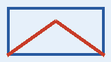

# A text in parts

Made to be cut: every place a part may begin is a rule (---) - Qt read a part beginning with one as front matter.

## Section 1
Paragraph 1 opens with these words and ends here.

- one
- two

---
## Section 2
Paragraph 2 opens with these words and ends here.

- one
- two

---
## Section 3
Paragraph 3 opens with these words and ends here.

- one
- two

---
## Section 4
Paragraph 4 opens with these words and ends here.

- one
- two

---
## Section 5
Paragraph 5 opens with these words and ends here.

- one
- two

---
## Section 6
Paragraph 6 opens with these words and ends here.

- one
- two

---
## Section 7
Paragraph 7 opens with these words and ends here.

- one
- two

---
## Section 8
Paragraph 8 opens with these words and ends here.

- one
- two

---
## Section 9
Paragraph 9 opens with these words and ends here.

- one
- two

---
## Section 10
Paragraph 10 opens with these words and ends here.

- one
- two

---
## Section 11
Paragraph 11 opens with these words and ends here.

- one
- two

---
## Section 12
Paragraph 12 opens with these words and ends here.

- one
- two

---
## Section 13
Paragraph 13 opens with these words and ends here.

- one
- two

---
## Section 14
Paragraph 14 opens with these words and ends here.

- one
- two

---
## Section 15
Paragraph 15 opens with these words and ends here.

- one
- two

---
## Section 16
Paragraph 16 opens with these words and ends here.

- one
- two

---
## Section 17
Paragraph 17 opens with these words and ends here.

- one
- two

---
## Section 18
Paragraph 18 opens with these words and ends here.

- one
- two

---
## Section 19
Paragraph 19 opens with these words and ends here.

- one
- two

---
## Section 20
Paragraph 20 opens with these words and ends here.

- one
- two

---
## Section 21
Paragraph 21 opens with these words and ends here.

- one
- two

---
## Section 22
Paragraph 22 opens with these words and ends here.

- one
- two

---
## Section 23
Paragraph 23 opens with these words and ends here.

- one
- two

---
## Section 24
Paragraph 24 opens with these words and ends here.

- one
- two

---

The end of the text.
