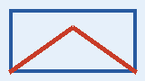

# Golden showcase

Prose with **bold**, *italic*, `inline code`, ~~struck~~, <mark>marked</mark>, a [link](https://example.org),
a bare https://example.com/path, H<sub>2</sub>O, <kbd>Ctrl</kbd>+<kbd>C</kbd> and a note[^1].

## Alerts and quotes

> [!NOTE]
> A note with a [link inside](https://example.org).

> [!WARNING]
> A warning with code:
>
> ```sh
> rm -rf build
> ```

> A quote.
>
> > A quote in the quote.

## Lists and tasks

- one item that is long enough to wrap onto a second line so the rhythm of a list can be judged by eye
- two
  - nested
- [ ] an open task
- [x] a done task

1. first
2. second

## Tables

| Left | Center | Right |
|:-----|:------:|------:|
| a | b | 1.50 |
| longer cell text | c | 22.50 |

```python
def greet(name: str) -> str:
    return f"Hello, {name}!"  # a comment
```

| Option | Meaning |
|---|---|
| `-v` | verbose |

## Math

Inline $\sum_{k=1}^{n} k^2$ and $E = mc^2$.

$$
f(x) = \begin{cases} x^2 & x \ge 0 \\ -x & x < 0 \end{cases}
$$

$$\frac{a}{b} + \sqrt{x}$$

## Details, images, badges

<details>
<summary>Folded</summary>

Hidden.

</details>

 

Term
: Its definition.

---

[^1]: The note.
